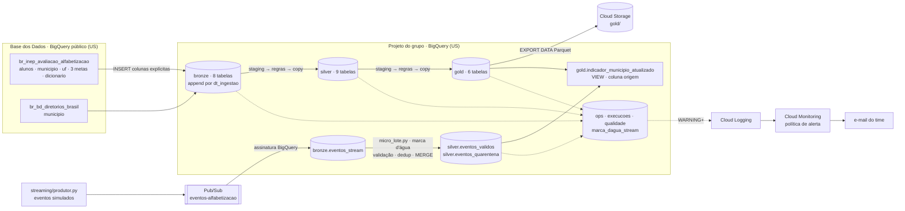

# Pipeline Híbrido para Análise da Alfabetização no Brasil

Tech Challenge da POS TECH, Fase 2. É uma pipeline medalhão (Bronze, Silver, Gold) no GCP
que integra, com ingestão batch e streaming, os dados do Indicador Criança Alfabetizada
(dataset `br_inep_avaliacao_alfabetizacao` da Base dos Dados). A pipeline valida a
qualidade antes de publicar cada camada, mede o próprio custo e avisa por e-mail quando
falha.

**Integrantes:** Halena Kulmann Duarte e Raphael Luciani

**Vídeo executivo:** [assistir no Google Drive](https://drive.google.com/file/d/183St0DmmJbZ6avJPffRZWJHW3l-GdR2x/view?usp=sharing)

| Resultado | Onde ver |
| --- | --- |
| Taxa nacional de 2024 recalculada dos microdados: **59,20**, contra **59,2** oficial | [Gold](#gold), `gold.validacao_microdado` |
| 87 regras de qualidade (69 bloqueantes) e falha demonstrada, com publicação barrada | [Qualidade de dados](#qualidade-de-dados) |
| Streaming: 626 mensagens = 588 válidas + 26 duplicadas + 12 inválidas, sem perda nem duplicação | [Streaming](#streaming) |
| Alerta por e-mail em menos de 1 minuto após a falha | [Monitoramento](#monitoramento) |
| Custo projetado em produção: ≈ US$ 5,62/mês sem cota gratuita, ≈ US$ 0,38 com ela | [FinOps](#finops) |
| Base de features para a fase 3, sem vazamento de alvo, exportada em Parquet | [Aplicação em IA](#aplicação-em-ia) |

## Sumário

1. [Contexto do problema](#contexto-do-problema)
2. [Arquitetura](#arquitetura)
3. [Tecnologias](#tecnologias)
4. [Estrutura do repositório](#estrutura-do-repositório)
5. [Como executar](#como-executar)
6. [Achados do perfil](#achados-do-perfil-etapa-1)
7. [Bronze](#bronze) · [Silver](#silver) · [Qualidade de dados](#qualidade-de-dados) · [Gold](#gold)
8. [Streaming](#streaming)
9. [Monitoramento](#monitoramento)
10. [FinOps](#finops)
11. [Aplicação em IA](#aplicação-em-ia)
12. [Decisões arquiteturais](#decisões-arquiteturais)
13. [Evidências](#evidências)
14. [Limitações conhecidas](#limitações-conhecidas) · [Evolução futura](#evolução-futura) · [Diferenciais](#diferenciais-do-enunciado)

## Contexto do problema

O **Compromisso Nacional Criança Alfabetizada** reúne União, estados, DF e municípios
em torno de um objetivo: que toda criança esteja alfabetizada ao fim do 2º ano do ensino
fundamental. Em 2023, a Pesquisa Alfabetiza Brasil, do INEP, fixou o ponto de corte de
**743 pontos** na escala de proficiência do Saeb. O **Indicador Criança Alfabetizada** é o
percentual de alunos avaliados que atinge esse patamar, calculado com o peso amostral.

Entender o indicador exige cruzar fontes que não falam a mesma língua: microdados de
alunos, resultados por município e UF, e as metas nacional, estaduais e municipais.
Elas usam códigos diferentes para a mesma rede, cobrem anos diferentes e têm lacunas.
Esta pipeline faz essa integração com regras explícitas e verificáveis. Ela produz uma
camada analítica confiável para acompanhar as metas, estudar desigualdades e treinar o
modelo preditivo da fase 3.

**Meta de 2030: duas leituras, separadas em todo o projeto.**
- **Meta pactuada** (fonte): a trajetória anual de 2024 a 2030 publicada nas tabelas de
  meta. Para a rede pública, `meta_alfabetizacao_2030 = 80`. Toda comparação "atingiu ×
  não atingiu" e toda distância até a meta usam esta leitura (`distancia_meta_pactuada`,
  `distancia_meta_pactuada_2030`).
- **Cenário aspiracional:** a universalização (100%). Aparece só na coluna
  `distancia_cenario_aspiracional` e nunca é usada como meta.

## Arquitetura

O diagrama mostra só o que foi implementado e executado.



**Fluxo batch** (`pipeline/orquestrador.py`):
1. **Bronze:** copia as 7 tabelas da fonte e o diretório de municípios, em append, com
   `dt_ingestao`, `id_execucao` e `fonte`. O esquema e a contagem são conferidos.
2. **Silver:** traduz os códigos pelo dicionário, cria a chave comum de rede
   (`rede_padrao`), liga município a UF e filtra os alunos avaliados.
3. **Gold:** compara resultado com meta pactuada, valida os microdados contra a taxa
   publicada e monta a base de features. Exporta tudo em Parquet.

Em Silver e Gold, cada tabela é gravada numa staging, passa pelas regras de qualidade e
só então é publicada. Se uma regra bloqueante reprova, a execução para, e a versão
anterior continua publicada.

**Fluxo streaming** (`streaming/`):
1. O produtor publica no Pub/Sub, e uma assinatura BigQuery grava cada mensagem como
   chegou.
2. O micro-lote processa a janela nova (marca d'água): valida, manda inválidos para a
   quarentena e deduplica por `id_evento` com `MERGE` idempotente.
3. A view da Gold junta oficial e simulado, separados pela coluna `origem`.

Toda etapa grava métricas em `ops`. Os erros vão ao Cloud Logging, e uma política do
Cloud Monitoring manda e-mail.

## Tecnologias

| Tecnologia | Para quê | Por quê | Situação |
| --- | --- | --- | --- |
| BigQuery | Todas as camadas, em SQL | A fonte já está no BigQuery público, então não há download nem transferência entre nuvens. O SQL cobre Bronze, Silver e Gold sem cluster para gerenciar | Implementado |
| Pub/Sub + assinatura BigQuery | Mensageria do streaming e recepção na Bronze | Entrega pelo menos uma vez, com `message_id` e `publish_time`, sem código consumidor para manter | Implementado |
| Cloud Storage | Exportação da Gold em Parquet (Snappy) | Formato aberto, para a fase 3 ler sem depender do BigQuery | Implementado |
| Cloud Logging + Cloud Monitoring | Registro de erros e alerta por e-mail | Política baseada em log dispara a cada erro, sem esperar agregação | Implementado |
| Python 3.11+ (`google-cloud-bigquery`, `-pubsub`, `-logging`, `-storage`) | Orquestrador, travas de custo, regras de qualidade, produtor, micro-lote | Lógica testável fora da nuvem | Implementado |
| YAML (`quality/regras.yaml`) | Declaração das 87 regras | Regras revisáveis sem mexer em código | Implementado |
| pytest | 238 testes das funções de transformação, validação e orquestração | Rodam sem GCP (BigQuery simulado) | Implementado |
| Bash + `gcloud`/`bq` (`infra/setup.sh`) | Criação idempotente de datasets, tabelas, bucket, tópico, assinatura e permissão | Reproduzível em um comando | Implementado |
| Cloud Scheduler + Cloud Run Job | Agendamento do batch e do micro-lote | Hoje a execução é manual | Evolução futura |
| Terraform | Infraestrutura declarativa, com estado e diff | Hoje são scripts idempotentes | Evolução futura |
| Looker Studio | Painel sobre a Gold e `ops` | Hoje as consultas são feitas no console | Evolução futura |

## Estrutura do repositório

| Componente | Arquivo | O que faz |
| --- | --- | --- |
| Configuração | `config/settings.py`, `.env.example` | Único lugar com IDs de projeto, bucket, tópico e datasets da fonte |
| Infraestrutura | `infra/setup.sh`, `infra/sql/*.sql` | Datasets `bronze`, `silver`, `gold`, `ops` (US), tabelas Bronze, streaming e observabilidade, bucket, tópico, assinatura e permissão |
| Cliente BigQuery | `pipeline/bq.py` | Dry run antes de toda consulta, aborta acima de `MAX_BYTES_BILLED` e executa com `maximum_bytes_billed` |
| Registro de execução | `pipeline/ops.py` | Grava cada etapa em `ops.execucoes`; falhas são gravadas e propagadas |
| Orquestrador | `pipeline/orquestrador.py` | Bronze → Silver → Gold, com dependência, retentativa, staging e publicação condicionada às regras |
| Bronze, Silver, Gold | `pipeline/bronze/*.sql`, `pipeline/silver/*.sql`, `pipeline/gold/*.sql` | Um SQL por tabela |
| Qualidade | `quality/regras.yaml`, `quality/runner.py` | Regras bloqueantes e informativas, gravadas em `ops.qualidade` |
| Streaming | `streaming/produtor.py`, `streaming/micro_lote.py`, `streaming/sql/*.sql` | Produtor, micro-lote e Gold do streaming |
| Logs e alerta | `pipeline/observabilidade.py`, `scripts/criar_alerta.py` | Erros no Cloud Logging e alerta do Cloud Monitoring |
| Perfil e investigação da fonte | `scripts/perfil_fonte.py`, `scripts/investigar_fonte.py`, `docs/dicionario_dados.md`, `docs/investigacao.md` | Colunas reais, divergências entre tabelas e anomalias apuradas |
| Medição de custo | `scripts/medir_custos.py` | Bytes faturados, armazenamento, volume do Pub/Sub e do bucket |
| Demonstração de falha | `scripts/injetar_falha/*.sql`, `--injetar-falha` | Dado ruim na staging, para provar que a regra bloqueante impede a publicação |
| Testes | `tests/` | 238 testes, sem dependência do GCP |
| Evidências | `evidencias/` | Prints, saídas de terminal e CSVs das execuções (ver [Evidências](#evidências)) |
| Plano e decisões | `docs/plano.md` | Roteiro, decisões e medições registradas durante o projeto |

## Como executar

Pré-requisitos:
- Python 3.11 ou mais novo (o desenvolvimento usou 3.13);
- [Google Cloud CLI](https://cloud.google.com/sdk/docs/install);
- um projeto GCP com faturamento ativo. O consumo do projeto fica dentro das cotas
  gratuitas (ver [FinOps](#finops)).

```bash
gcloud auth login
gcloud auth application-default login

cp .env.example .env      # preencha GCP_PROJECT, GCS_BUCKET e ALERT_EMAIL
make setup                # ambiente virtual + dependências
make testes               # deve passar sem acesso ao GCP
make infra                # cria os recursos no GCP (pode rodar de novo: só cria o que falta)
make alerta               # canal de e-mail + política de alerta
make perfil               # gera docs/dicionario_dados.md
make bronze               # carga append das 8 tabelas em bronze.*
make silver               # Silver: staging -> regras -> publicação
make gold                 # Gold: staging -> regras -> publicação -> Parquet no bucket
make produtor             # streaming: 5 eventos/s por 2 min (em um terminal)
make micro-lote           # streaming: 10 micro-lotes, um por minuto (em outro terminal)
```

`make pipeline` roda Bronze, Silver e Gold em sequência. Sem `make` (comum no Windows),
os mesmos passos no Git Bash:

```bash
python -m venv .venv && .venv/Scripts/python -m pip install -r requirements.txt
.venv/Scripts/python -m pytest -q
bash infra/setup.sh
.venv/Scripts/python -m scripts.criar_alerta                    # ver a nota abaixo
.venv/Scripts/python -m scripts.perfil_fonte
.venv/Scripts/python -m pipeline.orquestrador                     # bronze, silver e gold
.venv/Scripts/python -m pipeline.orquestrador --camadas gold --tabelas features_ml
.venv/Scripts/python -m streaming.produtor --eventos-por-segundo 5 --duracao-s 120
.venv/Scripts/python -m streaming.micro_lote --lotes 5 --intervalo-s 60
.venv/Scripts/python -m scripts.medir_custos                      # quantidades para o FinOps
```

**Nota sobre o alerta.** O canal de e-mail e a política levam alguns minutos para ficar
disponíveis no Cloud Monitoring depois de criados. Se `make alerta` falhar na primeira
vez, rode de novo depois de alguns minutos: o script é idempotente e só cria o que
falta. Pelo mesmo motivo, espere alguns minutos antes de testar o alerta com
`--injetar-falha`.

Para olhar a fonte antes de criar a infraestrutura: `make perfil-sem-ops`. Para reproduzir
a investigação: `python -m scripts.investigar_fonte`, que lê, entre outras, a staging
`gold.validacao_microdado_stg` deixada por uma execução reprovada.

## Achados do perfil (etapa 1)

Fonte: `docs/dicionario_dados.md` (execução `20261102T160721Z_9ebf14`), a tabela
`dicionario` agregada por coluna e chave (`evidencias/fase1_dicionario_agregado.csv`) e
`docs/perfil/investigacao.json`. Evidências e decisões completas em
[`docs/investigacao.md`](docs/investigacao.md).

| # | Achado | Consequência para a Silver |
| --- | --- | --- |
| 1 | O `dicionario` é consistente: cada par (coluna, chave) tem **um único significado** em todas as tabelas onde aparece (coluna `significados` = 1 nas 14 linhas). | Uma única tabela de tradução serve para `alunos`, `uf` e `municipio`. |
| 2 | `rede` é **código** (`'0'`…`'6'`, STRING) em `alunos`, `uf` e `municipio`, e **texto** nas metas: `'Pública'` em `meta_alfabetizacao_brasil`/`_uf`, `'Municipal'` em `meta_alfabetizacao_municipio`. O texto das metas não está no dicionário. | Join direto por `rede` casaria 0 linhas. Medido pela taxa igual dos dois lados: `'Pública'` = código `5` (42 de 49 pares UF-ano) e `'Municipal'` = código `3` (10.654 pares de 10.704 metas). A Silver cria `rede_padrao` com esse mapeamento. |
| 3 | Cada tabela tem um universo de rede diferente: `uf`/`municipio` têm `0, 2, 3, 5`; `alunos` tem `2, 3, 4`; os códigos `1` (Federal) e `6` existem no dicionário mas não aparecem nos dados. | Resultado só é comparado com meta do mesmo recorte de rede. Um check exige zero linhas em `rede_padrao = 'desconhecido'`. |
| 4 | `uf` não tem **DF** nem **RR**; `meta_alfabetizacao_uf` tem as 27 UFs. | RR não tem resultado em 2023–2024 em nenhuma tabela, e AC não tem em 2023. DF não tem resultado em 2023 e, em 2024, só aparece em `municipio` (Brasília, 59,13, igual à meta de UF) e `alunos`. Meta sem resultado recebe o estado `sem_resultado`, não "não atingiu". |
| 5 | **2025** só existe em `meta_alfabetizacao_brasil` e `meta_alfabetizacao_uf` (com `taxa_alfabetizacao`). `alunos`, `uf`, `municipio` e `meta_alfabetizacao_municipio` vão até 2024. | A série temporal por município termina em 2024; o ponto de 2025 só existe para Brasil e UF e vem das tabelas de meta. |
| 6 | `serie` tem um único valor (`'2'`, 2º ano). | Coluna mantida para o filtro de recorte, sem variação analítica. |
| 7 | `meta_alfabetizacao_municipio.nivel_alfabetizacao` (INT64) não tem entrada no dicionário. | É a taxa em faixas (0: <40 … 5: ≥80). Fica fora de `gold.features_ml` por vazamento de alvo. |
| 8 | Em `alunos`, o ausente tem `alfabetizado = '0'`, e não nulo; peso e proficiência são nulos fora do universo avaliado (presente **e** caderno preenchido: 1.502.809 alunos em 2023 e 1.851.852 em 2024). | A taxa recalculada usa só os avaliados como denominador; incluir os ~245–268 mil ausentes por ano puxaria a taxa para baixo. |
| 9 | A meta nacional de 2025 vem publicada com a trajetória arredondada (60, 64, 67…), e não existe meta para 2023, que é a linha de base. | Resultado do ano *Y* comparado com `meta_alfabetizacao_Y` da linha do mesmo ano; 2023 = `sem_meta`. |

## Bronze

`pipeline/orquestrador.py` copia as 7 tabelas do dataset de alfabetização, mais o
diretório de municípios da Base dos Dados, para o dataset `bronze`. A ordem é
`dicionario`, `diretorio_municipio`, `meta_brasil`, `meta_uf`, `meta_municipio`, `uf`,
`municipio`, `alunos`.

O diretório (`br_bd_diretorios_brasil.municipio`) entra porque `municipio` e
`meta_alfabetizacao_municipio` não têm `sigla_uf`. Sem ele, a Gold não liga município a
UF nem a região. Ele é o mesmo diretório que as consultas geradas pelo site da Base dos
Dados usam (`consultas_basedosdados/`). Das 27 colunas, a Bronze guarda 8:
`id_municipio`, `nome`, `capital_uf`, `id_uf`, `sigla_uf`, `nome_uf`, `nome_regiao` e
`amazonia_legal`. O resto (centroide GEOGRAPHY, códigos TSE/RF/BCB, outras
regionalizações) não serve a nenhuma análise prevista. Por isso as colunas fora do
subconjunto não geram aviso de "coluna nova". Cada tabela tem um SQL em `pipeline/bronze/<tabela>.sql` com as colunas
listadas uma a uma, sem `SELECT *`. O DDL em `infra/sql/bronze.sql`, criado pelo
`infra/setup.sh`, é o contrato de esquema.

**Política de escrita (histórico preservado).** A carga é sempre
`INSERT INTO ... SELECT`. Na Bronze nunca se usa `WRITE_TRUNCATE`, `CREATE OR REPLACE`
nem sobrescrita de partição. Cada linha leva três colunas de controle:

| Coluna | Conteúdo |
| --- | --- |
| `dt_ingestao` | data (UTC) da carga; é a coluna de partição |
| `id_execucao` | execução que gravou a carga (o mesmo id de `ops.execucoes`) |
| `fonte` | tabela de origem, ex.: `basedosdados.br_inep_avaliacao_alfabetizacao.uf` |

Duas execuções no mesmo dia geram duas cargas na mesma partição, com `id_execucao`
diferentes. A Silver lê a carga aprovada mais recente (por `id_execucao`). Cada `INSERT` tem
um `NOT EXISTS` por (`dt_ingestao`, `id_execucao`), então a retentativa do orquestrador
não duplica uma carga que já tinha sido gravada.

**Quando a fonte é atualizada.** Toda execução grava uma carga nova ao lado das
anteriores, e a Silver passa a usar a mais recente. As versões antigas continuam
disponíveis para comparação.

**Travas por tabela.** Cada uma interrompe a execução com erro e grava
`status = 'falhou'` em `ops.execucoes`:
1. Antes do `INSERT`, o esquema da fonte é comparado com o da tabela Bronze. Coluna
   removida ou com tipo alterado para a carga; coluna nova só gera aviso no log.
2. Depois do `INSERT`, as linhas gravadas precisam ser iguais às linhas da fonte.

**Retentativa.** Erros transitórios do BigQuery (5xx, 429) são repetidos até 3 vezes,
com espera de 5 s e 10 s. Os demais erros sobem direto.

**Custo.** A carga de `alunos` escaneia 256,1 MiB na fonte (dry run medido no perfil);
as outras seis tabelas somam menos de 3 MiB. O tamanho do diretório não pôde ser lido
antes da carga (`__TABLES__` de `br_bd_diretorios_brasil` dá 403). Ele foi medido na
própria carga: 5.571 linhas, 370 KiB estimados e 20 MiB faturados (o piso de 10 MB por
tabela referenciada). As tabelas são clusterizadas por `ano` e
`id_municipio` ou `sigla_uf`. `bronze.alunos` exige filtro de partição
(`require_partition_filter`), para nenhuma leitura varrer todas as cargas sem querer.

## Silver

Os SQLs ficam em `pipeline/silver/<tabela>.sql` e são executados por
`pipeline/orquestrador.py --camadas silver`. A Silver é reconstruível a partir da
Bronze, por isso usa `CREATE OR REPLACE`.

**Qual carga da Bronze é lida.** Para cada tabela, a carga mais recente que terminou com
`status = 'sucesso'` em `ops.execucoes`, ou seja, uma que passou pelas travas de esquema e
contagem. No SQL, o marcador `{carga_<tabela>}` vira o filtro
`dt_ingestao = DATE '…' AND id_execucao = '…'`. Ele inclui a partição, que é obrigatória
em `bronze.alunos`.

**Publicação.** Cada tabela passa por três passos:
1. É gravada em `silver.<tabela>_stg`.
2. As regras de `quality/regras.yaml` rodam sobre a staging.
3. Se nenhuma bloqueante reprovar, a staging é copiada para `silver.<tabela>` (copy job,
   sem custo de bytes) e removida.

Se uma bloqueante reprovar, a execução para com erro. A versão anterior de
`silver.<tabela>` continua publicada, e a staging fica no dataset para inspeção.

| Tabela | Grão | O que faz |
| --- | --- | --- |
| `dicionario` | id_tabela × coluna × chave | Tradução oficial de códigos |
| `diretorio_municipio` | município | Nome, UF, região, capital e Amazônia Legal |
| `rede` | origem × valor | Chave comum `rede_padrao`: código `5` e texto `'Pública'` viram `publica`, código `3` e `'Municipal'` viram `municipal` ([investigação](docs/investigacao.md) §1 e §2) |
| `resultado_uf` | ano × UF × rede × série | Resultado oficial com rede, série e região traduzidas |
| `resultado_municipio` | ano × município × rede × série | Idem, com nome e UF do município |
| `meta_brasil`, `meta_uf`, `meta_municipio` | publicação (ano) × território | Trajetória pactuada 2024–2030. A taxa da tabela de meta vira `taxa_referencia_meta`, e `nivel_alfabetizacao` vira `faixa_taxa_alfabetizacao` |
| `alunos_avaliados` | ano × aluno | Só presentes com caderno preenchido, `alfabetizado` 0/1 e peso amostral. Particionada por ano |

Nulos são preservados: nenhuma taxa, meta ou proficiência é preenchida com zero, e um
teste reprova qualquer `COALESCE(…, 0)` nos SQLs da Silver.

## Qualidade de dados

`quality/regras.yaml` declara cada regra com tabela, severidade, operador, limiar e uma
consulta que devolve um número. `quality/runner.py` junta as regras de uma tabela numa
única query: o BigQuery cobra no mínimo 10 MB por tabela referenciada em cada query, e
uma query por regra multiplicaria esse piso. O runner grava todos os resultados em
`ops.qualidade` (um load job por tabela) antes de decidir. Se alguma bloqueante
reprovar, levanta `QualidadeBloqueanteError`. Nenhum `except` engole esse erro: o
`registrar_etapa` grava `status = 'falhou'` em `ops.execucoes` e propaga a exceção.

O enunciado alerta para o `except` genérico que registra a falha e deixa o processo
terminar com sucesso. O código tem 4 `except Exception`, e nenhum faz isso:

| Onde | O que faz |
| --- | --- |
| `pipeline/ops.py` (`registrar_etapa`) | Se a gravação em `ops.execucoes` falhar, registra o erro. Se a etapa já tinha falhado, a exceção original continua subindo; senão, a falha de gravação sobe |
| `pipeline/orquestrador.py` (`com_retentativa`) | Repete só erro transitório do BigQuery (5xx, 429), até 3 vezes. Qualquer outro erro, ou o último transitório, sobe com `raise` |
| `pipeline/observabilidade.py` (`configurar_logs`) | Se o Cloud Logging estiver indisponível, a pipeline roda, mas registra um ERROR dizendo que falhas daquela execução não vão alertar |
| `scripts/perfil_fonte.py` | O perfil da fonte segue sem a contagem de linhas quando `__TABLES__` é bloqueado (fora da pipeline) |

Na Silver são 51 regras: 44 bloqueantes e 7 informativas. A Gold acrescenta 29 (22
bloqueantes e 7 informativas; ver [Gold](#gold)), e o micro-lote do streaming mais 7 (3
bloqueantes e 4 informativas; ver [Streaming](#streaming)). São 87 no total.

| Tipo | Regras | Severidade |
| --- | ---: | --- |
| Duplicidade de chave (uma por tabela) | 9 | bloqueante |
| Código sem tradução: `rede_padrao = 'desconhecido'`, série sem descrição, código de presença/caderno/alfabetizado fora do dicionário, código com dois significados | 12 | bloqueante |
| Chave de relacionamento: `id_municipio` com 7 dígitos, município sem UF no diretório | 4 | bloqueante |
| Faixa de valor: taxa e metas entre 0 e 100, peso amostral positivo | 6 | bloqueante |
| **Taxa de correspondência dos joins** com o diretório, limiar 100% | 5 | bloqueante |
| Tabela vazia ou cobertura mínima (diretório ≥ 5.570 municípios, 27 UFs por publicação de meta) | 8 | bloqueante |
| Nulos e universo: taxa nula, meta sem 2030, meta 2030 ≠ 80, proficiência nula, proporção de avaliados ≥ 80% | 7 | informativa |

**Por que 100% nos joins com o diretório.** O diretório é a lista oficial de municípios
do IBGE (5.571). Um código que não casa não é lacuna da fonte: é chave errada ou
município novo. Nos dois casos, a linha ficaria sem UF e sumiria das agregações sem
aviso. Os joins entre resultado e meta, com limiares medidos na investigação (99% para
município e cobertura observada para UF), entram na Gold.

### Demonstração de falha

Um relatório só com aprovações não prova que a trava funciona. `--injetar-falha` roda um
cenário de `scripts/injetar_falha/` na **staging**, depois que ela é montada e antes das
regras. A Bronze e a Silver publicada não são alteradas.

| Cenário | O que simula | Regra que precisa reprovar |
| --- | --- | --- |
| `resultado_municipio__rede_desconhecida` | a fonte passa a mandar a rede `'9'`, sem entrada no dicionário | `resultado_municipio_rede_desconhecida` |
| `resultado_municipio__chave_duplicada` | carga reprocessada que duplica São Paulo / municipal / 2024 | `resultado_municipio_chave_duplicada` |

```bash
.venv/Scripts/python -m pipeline.orquestrador --camadas silver --tabelas resultado_municipio     --injetar-falha resultado_municipio__rede_desconhecida
echo "código de saída: $?"     # diferente de 0
```

Evidências que a execução deixa (consultas no console do BigQuery):

```sql
-- 1. a regra bloqueante reprovou
SELECT id_execucao, regra, severidade, valor_medido, limiar, status
FROM `SEU_PROJETO.ops.qualidade`
WHERE status = 'reprovada' AND severidade = 'bloqueante'
ORDER BY ts_validacao DESC;

-- 2. a etapa terminou como falha, com a mensagem do erro
SELECT id_execucao, etapa, status, mensagem_erro
FROM `SEU_PROJETO.ops.execucoes`
WHERE status = 'falhou' ORDER BY inicio DESC;

-- 3. a linha ruim ficou na staging e não chegou à tabela publicada
SELECT 'staging' AS tabela, COUNTIF(rede = '9') AS linhas_rede_9
FROM `SEU_PROJETO.silver.resultado_municipio_stg`
UNION ALL
SELECT 'publicada', COUNTIF(rede = '9') FROM `SEU_PROJETO.silver.resultado_municipio`;
```

**Execução registrada** (`20261102T204419Z_22674a`, cenário
`resultado_municipio__rede_desconhecida`):

| Evidência | Arquivo | O que mostra |
| --- | --- | --- |
| Terminal | `evidencias/fase2_pipeline_falhou.jpg` | `FALHA INJETADA`, `REPROVADA [bloqueante] resultado_municipio_rede_desconhecida: valor=1.0 limiar = 0.0`, `QualidadeBloqueanteError` e `código de saída: 1` |
| Consultas 1 e 2 | `evidencias/fase2_demonstracao_falha1.jpg`, `..._falha2.jpg` | regra `reprovada` em `ops.qualidade` e etapa `falhou` em `ops.execucoes` |
| Consulta 3 | `evidencias/fase2_demonstracao_falha3.jpg` | 1 linha com rede `'9'` na staging e **0** na tabela publicada |

As outras 7 regras da tabela (6 bloqueantes e 1 informativa) aprovaram na mesma execução. A regra
`resultado_municipio_vazio` mediu 23.996 linhas: as 23.995 da fonte mais a linha injetada.

Para voltar ao estado normal, rode a mesma tabela sem a opção. A staging é recriada a
partir da Bronze, aprovada e removida:
`.venv/Scripts/python -m pipeline.orquestrador --camadas silver --tabelas resultado_municipio`.

## Gold

Os SQLs ficam em `pipeline/gold/<tabela>.sql` e são executados por
`pipeline/orquestrador.py --camadas gold`. O fluxo é o mesmo da Silver: staging, regras,
publicação. Depois de publicada, cada tabela é exportada em Parquet (Snappy) para
`gs://<GCS_BUCKET>/gold/<tabela>/id_execucao=<id>/`, que é o insumo da fase 3. Cada
execução grava num prefixo novo (`overwrite = false`), então as exportações anteriores
continuam disponíveis.

| Tabela | Grão | Entidades | Para quê |
| --- | --- | --- | --- |
| `indicador_municipio` | município × ano × rede | municipio, meta_municipio, diretório | Indicador × meta pactuada municipal |
| `indicador_uf` | UF × ano × rede | uf, meta_uf, municipio (DF), diretório | Indicador × meta pactuada estadual, de 2023 a 2025 |
| `validacao_microdado` | nível (município, UF, Brasil) × ano × rede | alunos, municipio, uf, meta_brasil | Taxa recalculada dos microdados × taxa publicada |
| `indicador_brasil` | ano × rede | meta_brasil, validacao, indicador_uf | Trajetória nacional × meta pactuada |
| `evolucao_temporal` | nível × território × rede × ano | os três indicadores | Variação em relação ao ano anterior disponível |
| `features_ml` | município × ano base | municipio, meta_municipio, alunos, uf, diretório | Base para o modelo da fase 3 |

As seis entidades do enunciado chegam à Gold, e um teste garante isso
(`test_as_seis_entidades_chegam_a_gold`).

**Regras de negócio no SQL.**
- **Status da meta em quatro estados:** `atingiu`, `nao_atingiu`, `sem_meta` e
  `sem_resultado`. A ausência de meta e a ausência de resultado são decididas antes da
  comparação, então nunca caem no `ELSE` como "não atingiu".
- **Meta pactuada da fonte.** A meta do ano *Y* é a coluna `meta_alfabetizacao_Y` da
  publicação do mesmo ano. As distâncias são `distancia_meta_pactuada` (até a meta do ano)
  e `distancia_meta_pactuada_2030` (até a meta de 2030, que é 80 na rede pública).
  **Cenário aspiracional:** a universalização aparece só em
  `distancia_cenario_aspiracional` (100 − taxa) e não é misturada com a meta pactuada em
  nenhuma outra coluna.
- **Mesmo recorte.** Resultado e meta só são comparados no mesmo `ano` e `rede_padrao`,
  e só na série do indicador (`serie = '2'`). A rede que não tem meta pactuada fica
  `sem_meta`.
- **FULL JOIN entre resultado e meta.** Uma meta sem resultado aparece como
  `sem_resultado`, em vez de sumir.
- **Ponderação.** `indicador_brasil` usa a taxa oficial e mostra, ao lado, a taxa
  recalculada dos microdados, a `media_ponderada_ufs` (pelos pesos dos avaliados) e a
  `media_simples_ufs`. Esta última está com esse nome justamente por não ser o indicador.
- **Origem.** Toda tabela da Gold tem `origem = 'oficial'`. Os eventos do streaming
  chegam com `origem = 'simulado'` à view `gold.indicador_municipio_atualizado`, e a
  coluna separa os dois.
- **De onde vem o resultado de UF** (coluna `fonte_resultado`): `resultado_uf`; ou o único
  município da UF, quando ela não tem linha própria (DF 2024 = Brasília); ou a própria
  `meta_uf`, quando o ano só existe ali (2025).

**Validação cruzada (diferencial).** `validacao_microdado` recalcula
`100 × Σ(peso × alfabetizado) / Σ peso` sobre os alunos avaliados, por município, e soma
os resultados para UF e Brasil. Assim, `alunos` é lida uma vez só. Depois compara com a
taxa publicada em `diferenca_pp`. `indicador_brasil` e `features_ml` reaproveitam a tabela,
em vez de varrer os microdados de novo.

**Regras da Gold** (22 bloqueantes, 7 informativas): chave única e status coerente em
todas as tabelas. Os limiares de correspondência entre resultado e meta foram medidos na
investigação: 99% no pior ano para município × meta (§3); 24 UFs com resultado em 2023 e
26 em 2024 (§4). Na validação, os limiares também são os valores medidos (§10): no
máximo 3 linhas de UF e 802 de município sem microdado, todas da lacuna da fonte
(SP 2023). A taxa nacional de 2024 recalculada precisa ficar a até 0,05 p.p. da oficial.
A regra `features_ml_coluna_com_vazamento` lê o `INFORMATION_SCHEMA` da staging e
bloqueia qualquer coluna `status`, `distancia` ou `faixa` na base de features.

**Resultado da validação cruzada** ([investigação](docs/investigacao.md) §10):

| Brasil, rede pública | UFs | recalculada | oficial | diferença |
| --- | ---: | ---: | ---: | ---: |
| 2024 | 27 | 59,20 | 59,2 | **0,00** |
| 2023 | 24 (sem SP) | 57,46 | 55,9 | +1,56 |

Em 2024, a taxa recalculada dos microdados bate com a oficial, e a maior diferença numa
UF é de 0,09 p.p. Isso confirma filtro, peso, denominador e chaves em todas as camadas
anteriores. Em 2023, a diferença vem principalmente de uma lacuna da fonte: São Paulo
não está nos microdados de alunos. Com SP estimado pelo peso de 2024, a diferença cairia
para cerca de 0,4 p.p.

A validação também achou erro na própria fonte (§10). Em 2023, para os municípios
2305100 e 2304905 (CE), a tabela `municipio` publica 91,67 e 99,15. Os microdados dão
55,61 e 83,11, e a tabela de meta traz 55,6 e 83,1.

**Execução** (`20261102T232157Z_b0292a`, a partir de `validacao_microdado`; as duas
primeiras tabelas são da execução `20261102T230818Z_2d4702`):

| Tabela | Linhas | Bytes faturados (staging + regras) |
| --- | ---: | ---: |
| `indicador_municipio` | 24.045 | 40 MiB |
| `indicador_uf` | 178 | 50 MiB |
| `validacao_microdado` | 34.201 | 222 MiB |
| `indicador_brasil` | 3 | 40 MiB |
| `evolucao_temporal` | 24.172 | 40 MiB |
| `features_ml` | 10.896 | 70 MiB |

A exportação Parquet de cada tabela faturou mais 10 MiB. Só `validacao_microdado` lê
volume real (212 MiB dos microdados). Nas outras, o custo é o piso de 10 MB por tabela
referenciada.

## Streaming

Simula atualizações de indicador chegando em tempo quase real: uma "nova medição" de 2025
para um município. Os números são **simulados**. Eles partem da taxa municipal oficial de
2024 somada a um ruído e nunca se misturam ao dado oficial sem identificação.

```
streaming/produtor.py ──► Pub/Sub (tópico eventos-alfabetizacao)
                              │ assinatura BigQuery (write_metadata)
                              ▼
                        bronze.eventos_stream      mensagem como chegou + message_id + publish_time
                              │ streaming/micro_lote.py, a cada N segundos, janela por marca d'água
                              ▼
                        silver.eventos_lote_stg ── regras (ops.qualidade) ── bloqueante? para
                              │ MERGE por id_evento          │ MERGE por message_id
                              ▼                              ▼
                        silver.eventos_validos         silver.eventos_quarentena (motivo)
                              │
                              ▼
                        gold.indicador_municipio_atualizado (VIEW: oficial + simulado, coluna origem)
```

**Mensageria.** O produtor publica JSON no tópico com os atributos `origem=simulado` e
`tipo_envio`. A assinatura do tipo BigQuery grava cada mensagem em `bronze.eventos_stream`
sem transformação. Isso inclui JSON quebrado, que precisa chegar à quarentena. A gravação
usa a conta de serviço do Pub/Sub, com permissão de escrita só nessa tabela
(`infra/setup.sh`).

**Evento:**
```json
{"id_evento": "uuid", "tipo": "atualizacao_indicador", "id_municipio": "4314902", "ano": 2025,
 "rede": "municipal", "taxa_alfabetizacao": 47.31, "ts_evento": "2026-11-03T12:00:00.123Z",
 "versao_schema": 1}
```

**Processamento incremental (micro-lote).** Cada execução segue estes passos:
1. Lê a marca d'água (`ops.marca_dagua_stream`) e processa a janela `(desde, ate]` de
   `publish_time`. O `ate` fica 30 s antes de "agora", para não pular mensagem que a
   assinatura ainda está gravando.
2. Valida cada evento. O primeiro defeito encontrado vira o `motivo` da quarentena:
   `json_invalido`, `campo_obrigatorio_ausente`, `tipo_desconhecido`,
   `municipio_inexistente`, `taxa_fora_0_100`, `ano_fora_da_trajetoria` ou
   `rede_desconhecida`.
3. Roda as regras do lote. As bloqueantes exigem `origem = simulado` em toda mensagem e
   que todo defeito injetado pelo produtor tenha sido detectado.
4. Faz `MERGE` dos válidos e da quarentena, grava a marca d'água e recria a view da Gold.

**Inválidos e duplicados.** O produtor injeta cerca de 3% de inválidos (5 tipos de defeito)
e reenvia cerca de 5% das mensagens com o mesmo `id_evento`, como faz um cliente depois
de um timeout. O Pub/Sub entrega pelo menos uma vez e pode somar duplicatas próprias,
com o mesmo `message_id`. O micro-lote trata os dois casos:
- **duplicado no lote:** mantém a 1ª publicação de cada `id_evento`;
- **duplicado de lote anterior:** marca como duplicado o `id_evento` que já está na
  Silver;
- **reprocessamento:** o `MERGE ... WHEN NOT MATCHED` não reinsere nada.

**Latência medida de fato.** São três relógios:
- `ts_evento`, do produtor, gravado quando o evento é criado;
- `publish_time`, do servidor do Pub/Sub;
- `ts_processamento`, do micro-lote.

`latencia_ingestao_s = publish_time − ts_evento` (produzido → ingerido) e
`latencia_ponta_a_ponta_s = ts_processamento − ts_evento`. Os p50 e p95 de cada lote vão
para `ops.execucoes` (`latencia_p50_s`, `latencia_p95_s`). Como os relógios são de
máquinas diferentes, latência negativa indica desvio de relógio, e uma regra informativa
conta esses casos.

**Batch × streaming:**

| Aspecto | Batch (Bronze → Gold) | Streaming (micro-lote) |
| --- | --- | --- |
| Gatilho | Execução do orquestrador | Chegada de mensagem no tópico; processada a cada N segundos |
| Frequência | Por atualização da fonte (anual na prática) | Contínua; lote a cada 60 s no `make micro-lote` |
| Latência | Horas a dias (até a próxima execução) | Segundos a minutos: ingestão medida em `latencia_*`, mais a espera do lote |
| Unidade | Tabela inteira (snapshot) | Janela de `publish_time` |
| Garantia de entrega | Lote completo ou nada; contagem conferida com a fonte | Pelo menos uma vez; exatamente uma vez na Silver por `MERGE` em `id_evento` |
| Dado ruim | Regra bloqueante para a camada | Evento vai para a quarentena; bloqueante (ex.: origem errada) para o lote |
| Reprocessamento | Rodar a camada de novo (Silver/Gold reconstruíveis) | Voltar a marca d'água; o `MERGE` é idempotente |

**Execução registrada** (`evidencias/fase3_streaming_terminal.txt`). O produtor publicou
626 mensagens em 2 minutos, e 5 micro-lotes rodaram em paralelo, um por minuto:

| | Produtor enviou | Micro-lotes processaram |
| --- | ---: | ---: |
| Válidos | 588 | 242 + 346 = 588 novos em `eventos_validos` |
| Duplicados (mesmo `id_evento`) | 26 | 11 + 15 = 26 descartados |
| Inválidos | 12 (json_invalido 3, sem_taxa 2, municipio_inexistente 6, tipo_desconhecido 1) | 4 + 8 = 12 na quarentena |
| Total | 626 | 257 + 369 = 626 |

A conta fecha exatamente: nada se perdeu e nada entrou duas vezes. Todo defeito
injetado foi detectado (`eventos_lote_defeito_nao_detectado = 0`). O 1º lote e os dois
últimos leram 0 mensagens: o 1º porque o produtor tinha acabado de começar e a margem é
de 30 s, os últimos porque o produtor já tinha terminado.

| Latência | p50 | p95 |
| --- | ---: | ---: |
| Ingestão (`publish_time − ts_evento`) | 0,073 s | 0,098 s a 0,976 s |
| Ponta a ponta (`ts_processamento − ts_evento`) | — | 80 s a 122 s |

A ingestão leva menos de 1 s. Quem domina a latência ponta a ponta é a espera do
micro-lote (intervalo de 60 s mais margem de 30 s). É esse o ponto a ajustar se o negócio
precisar de números mais frescos.

**Custo medido por micro-lote** (bytes faturados nos logs):

| Consulta | Lote com eventos | Lote vazio |
| --- | ---: | ---: |
| marca d'água | 10 MiB | 10 MiB |
| staging (Bronze + diretório + Silver) | 30 MiB | 30 MiB |
| estatísticas | 10 MiB | 0 |
| regras do lote | 10 MiB | — |
| `MERGE` válidos + quarentena | 40 MiB | — |
| view da Gold | 0 | 0 |
| **Total** | **≈ 100 MiB** | **≈ 40 MiB** |

O volume de dados lido é de dezenas de KiB. O custo vem do piso de 10 MB por tabela
referenciada, então a cadência é a principal alavanca:

| Cadência (com eventos o tempo todo) | Faturado por mês | Custo das consultas on-demand (US$ 6,25/TiB, 1 TiB grátis) |
| --- | ---: | ---: |
| 1 lote por minuto | ≈ 4,1 TiB | ≈ US$ 19,50 |
| 1 lote a cada 5 minutos | ≈ 0,82 TiB | US$ 0 (dentro da cota gratuita) |
| 1 lote a cada 15 minutos | ≈ 0,27 TiB | US$ 0 |

**Para rodar** (depois de `bash infra/setup.sh`, que cria as tabelas, a permissão e a
assinatura), em dois terminais:
```bash
.venv/Scripts/python -m streaming.produtor --eventos-por-segundo 5 --duracao-s 120
.venv/Scripts/python -m streaming.micro_lote --lotes 5 --intervalo-s 60
```

## Monitoramento

| O que | Onde fica | Como |
| --- | --- | --- |
| Execução de cada etapa | `ops.execucoes` (append, particionada por dia) | `registrar_etapa`: início, fim, duração, linhas de entrada e saída, bytes estimados/processados/faturados, job ids, status e mensagem de erro |
| Qualidade | `ops.qualidade` (append) | Cada regra em cada execução: valor medido, limiar, aprovada ou reprovada |
| Latência do streaming | `ops.execucoes.latencia_p50_s` / `latencia_p95_s` | p50 e p95 de `publish_time − ts_evento` em cada micro-lote |
| Volume | `ops.execucoes.linhas_*`, `bytes_faturados` | Por etapa e por execução |
| Progresso do streaming | `ops.marca_dagua_stream` | Janela processada e eventos lidos em cada lote |
| **Falha** | Cloud Logging → Cloud Monitoring → e-mail | Ver abaixo |

As tabelas `ops` acumulam histórico. Nenhuma execução sobrescreve a anterior, porque a
gravação é por load job em modo `WRITE_APPEND`.

**Alerta de falha.** Os três processos (`pipeline.orquestrador`, `streaming.micro_lote`,
`streaming.produtor`) mandam os logs de WARNING para cima ao Cloud Logging, no log
`pipeline-alfabetizacao` com o label `pipeline=alfabetizacao`. O envio é síncrono, para o
erro chegar antes de o processo sair. Toda etapa que falha gera um ERROR (o
`registrar_etapa` grava `falhou` e propaga a exceção). Toda exceção que encerra o
processo, dentro ou fora das etapas (configuração ou permissão, por exemplo), também é
registrada como CRITICAL em `rodar_com_alerta`. No teste, a mesma falha gerou ERROR às
21:31:38 e CRITICAL às 21:31:42, no horário de Brasília.

`scripts/criar_alerta.py` (`make alerta`) cria, de forma idempotente:
- o **canal de notificação** por e-mail para o `ALERT_EMAIL` do `.env`;
- a **política de alerta baseada em log** "Pipeline alfabetização: falha", que abre um
  incidente para qualquer entrada `severity>=ERROR` desse log. O limite é de 1 e-mail a
  cada 5 minutos, e o incidente fecha sozinho em 30 minutos.

INFO não vai para a nuvem: fica no terminal, para não pagar ingestão de log sem uso.

**Em produção, quem descobre que a pipeline quebrou, e em quanto tempo?** Quem descobre
é o time, pelo e-mail configurado em `ALERT_EMAIL`, **em menos de 1 minuto**. No teste com
`--injetar-falha`, o log de ERROR foi registrado no Cloud Logging às 21:31:38. O e-mail
"[ALERT - Error] Pipeline alfabetização: falha" chegou às 21:31 (9:31 PM, incidente aberto
às 00:31 UTC). O e-mail
traz o passo a passo da política: olhar `ops.execucoes` e `ops.qualidade`, sabendo que a
camada seguinte não foi publicada.

| Evidência | Arquivo |
| --- | --- |
| Erro no terminal | `evidencias/fase4_falha_terminal.jpg` |
| Entradas ERROR e CRITICAL no Cloud Logging | `evidencias/fase4_logs_monitor_erro.jpg`, `evidencias/fase4_logs_monitor_critico.jpg` |
| Filtro da política casando com as entradas da pipeline | `evidencias/fase4_filtro_da_politica.png` |
| E-mail do Cloud Monitoring | `evidencias/fase4_falha_email.jpg` |

Ficam fora deste alerta:
- **a pipeline não rodar:** sem execução, não há erro. Uma política de ausência em
  `ops.execucoes` (ex.: nenhuma linha em 26 h) está **planejada**;
- **o micro-lote travar sem erro:** a marca d'água para de avançar. Isso aparece em
  `ops.marca_dagua_stream`, mas também ainda não há alerta automático.

## FinOps

Todos os números abaixo foram **medidos** por `scripts/medir_custos.py` e estão em
`docs/perfil/medicoes_custo.json`. As fontes são:
- `ops.execucoes`, para os bytes faturados de cada job;
- a API de metadados do BigQuery, para o armazenamento;
- `bronze.eventos_stream`, para o volume do Pub/Sub;
- a listagem do bucket, para os arquivos Parquet.

O projeto tem faturamento ativo. Todo o desenvolvimento, com 28 execuções e 58 etapas,
faturou **4,12 GiB** de consultas, dentro da cota gratuita de 1 TiB/mês.

### Práticas aplicadas

| Prática | Onde | Efeito medido |
| --- | --- | --- |
| Trava de custo dupla: dry run com teto + `maximum_bytes_billed` | `pipeline/bq.py`, toda consulta | Nenhum job passou do teto de 5 GiB; a etapa mais cara (`silver_alunos_avaliados`, 3 jobs) faturou 724 MiB |
| Colunas explícitas, sem `SELECT *` sobre a fonte ou sobre alunos | todos os SQLs da Bronze e da Silver. O `SELECT *` aparece só em CTEs ou tabelas pequenas do próprio projeto: `pipeline/gold/indicador_uf.sql`, `streaming/sql/merge_validos.sql`, `streaming/sql/gold_indicador_municipio_atualizado.sql` e a exportação Parquet | `validacao_microdado` lê 212 MiB dos 294 MiB de `silver.alunos_avaliados` |
| Partição e cluster | Bronze por `dt_ingestao` (`require_partition_filter` em `alunos`); `alunos_avaliados` por ano; cluster por município/UF | A leitura fica restrita à carga escolhida |
| Microdados lidos uma vez só na Gold | `validacao_microdado`, reaproveitada por `indicador_brasil` e `features_ml` | 1 leitura de 212 MiB em vez de 3 |
| Regras de uma tabela numa única consulta | `quality/runner.py` | 10 MiB por tabela, em vez de 10 MiB por regra (87 regras) |
| Cópia gratuita para publicar | copy job da staging para a tabela final | 0 bytes na publicação |
| Gold do streaming como VIEW | `gold.indicador_municipio_atualizado` | 0 bytes por lote |
| Parquet com Snappy para a fase 3 | `EXPORT DATA` da Gold | 6 tabelas com 93.495 linhas em 1,94 MiB no bucket |
| Só WARNING+ no Cloud Logging | `pipeline/observabilidade.py` | Ingestão de log desprezível |
| Mesma região (US) da fonte | todos os datasets | Sem transferência entre regiões ou nuvens |

### Quantidades medidas

| Item | Medido |
| --- | ---: |
| Pipeline batch completa (Bronze 397 + Silver 961 + Gold 522 MiB) | 1.880 MiB = **1,84 GiB** por execução |
| Micro-lote com eventos / vazio | **≈ 100 MiB / ≈ 40 MiB** por lote |
| Armazenamento BigQuery: bronze 1.160, silver 287, gold 11 MiB | **1,42 GiB** |
| Uma carga de `bronze.alunos` | 573 MiB (fonte: 256 MiB) |
| Mensagem do Pub/Sub (dados + atributos) | **282 bytes** em média (626 mensagens, 176.607 bytes) |
| Exportação Parquet da Gold | **1,94 MiB** por execução |

### Estimativa de custo mensal em produção

Cadência pretendida:
- **batch completo uma vez por mês:** a fonte é anual; uma execução mensal cobre
  correções e reprocessamento;
- **micro-lote a cada 5 minutos:** 288 lotes por dia.

Premissas que não vêm da medição, porque o streaming é simulado e não há volume real:
- há eventos em todos os lotes (pior caso; lote vazio custa 40% do cheio);
- chega 1 evento por segundo (2,6 milhões por mês).

Preços de lista em US multi-região, consultados nas páginas oficiais em 03/11/2026:
[BigQuery](https://cloud.google.com/bigquery/pricing),
[Pub/Sub](https://cloud.google.com/pubsub/pricing),
[Cloud Storage](https://cloud.google.com/storage/pricing),
[Cloud Logging e Cloud Monitoring](https://cloud.google.com/products/observability/pricing) e
[exemplos de preço de alertas](https://cloud.google.com/stackdriver/observability-pricing-examples).
A coluna de custo não aplica cota gratuita; as cotas entram só na última linha.

| Serviço | Unidade | Quantidade medida → projetada/mês | Preço unitário | Custo mensal projetado |
| --- | --- | --- | --- | ---: |
| BigQuery, consultas do batch | TiB faturado | 1,84 GiB × 1 execução = 0,0018 TiB | US$ 6,25/TiB (1º TiB/mês grátis) | US$ 0,01 |
| BigQuery, consultas do streaming | TiB faturado | 100 MiB × 288 × 30 = 0,82 TiB | US$ 6,25/TiB (1º TiB/mês grátis) | US$ 5,15 |
| BigQuery, armazenamento ativo lógico | GiB-mês | 1,42 GiB (+0,57 GiB por carga mensal da Bronze) | US$ 0,000031507/GiB-hora ≈ US$ 0,023/GiB-mês (10 GiB/mês grátis) | US$ 0,03 |
| BigQuery, armazenamento do streaming | GiB-mês | 282 B × 2,6 mi ≈ 0,68 GiB na Bronze + Silver | ≈ US$ 0,023/GiB-mês | US$ 0,02 |
| Pub/Sub, publicação | TiB | 0,68 GiB | US$ 40/TiB (10 GiB/mês grátis) | US$ 0,03 |
| Pub/Sub, assinatura BigQuery (leitura + gravação no BigQuery) | TiB | 0,68 GiB | US$ 50/TiB (sem cota gratuita; sem custo extra de ingestão no BigQuery) | US$ 0,03 |
| Cloud Storage, Parquet da Gold | GiB-mês | 1,94 MiB por exportação | US$ 0,026/GB-mês Standard (5 GiB grátis) | < US$ 0,01 |
| Cloud Logging | GiB ingerido | só WARNING+: KiB por mês | US$ 0,50/GiB (50 GiB/projeto/mês grátis) | < US$ 0,01 |
| Cloud Monitoring, alerta baseado em log | referência de métrica | 1 política com 1 condição = 1 referência; não retorna pontos | US$ 0,35/referência/mês | US$ 0,35 |
| **Total sem cota gratuita** | | | | **≈ US$ 5,62** |
| **Total com cota gratuita** | | | | **≈ US$ 0,38** |

Com as cotas gratuitas, sobram só a assinatura BigQuery do Pub/Sub (US$ 0,03), que não
tem cota, e o alerta (US$ 0,35).

**A cadência do micro-lote é o que define o custo.** O volume de eventos quase não pesa:

| Cadência do micro-lote | Consultas/mês | Custo das consultas (cota gratuita aplicada) |
| --- | ---: | ---: |
| 1 por minuto | 4,12 TiB | ≈ US$ 19,50 |
| 1 a cada 5 minutos | 0,82 TiB | US$ 0 |
| 1 a cada 15 minutos | 0,27 TiB | US$ 0 |

### O que a medição revelou

1. **Piso de 10 MB por tabela.** Em tabelas pequenas, o custo de cada consulta é o
   mínimo cobrado, e não o volume lido. Por exemplo, a carga do diretório estimou
   370 KiB e faturou 20 MiB. Por isso as regras foram agrupadas por tabela e a Gold do
   streaming virou VIEW.
2. **Colunas de controle custam mais que o dado na Bronze de alunos.** Uma carga de
   `bronze.alunos` ocupa 573 MiB, contra 256 MiB na fonte. Os 317 MiB a mais são
   `fonte`, `id_execucao` e `dt_ingestao` repetidos em 3,87 milhões de linhas: cerca de
   86 bytes por linha, quase todos da `fonte`, um texto de 51 caracteres. No modelo de
   armazenamento lógico, valor repetido não é comprimido. **Planejado:** cobrar o
   dataset `bronze` pelo armazenamento físico (comprimido) ou guardar `fonte` como
   código curto.
3. **Duas cargas no mesmo dia dobram a leitura da Silver.** As duas cargas de teste
   ficaram na mesma partição de `dt_ingestao`. Como a tabela não é clusterizada por
   `id_execucao`, a Silver de alunos leu as duas e faturou 724 MiB. **Planejado:**
   incluir `id_execucao` no cluster de `bronze.alunos`. Com uma carga por dia, a
   leitura cai pela metade.
4. **O armazenamento do streaming não aparece nos metadados.** `bronze.eventos_stream`
   mostra 0 linhas na API de metadados, porque a assinatura grava pela Storage Write
   API e os dados ainda estão no buffer de escrita. O volume foi medido por consulta
   (626 mensagens, 176.607 bytes).

## Aplicação em IA

`gold.features_ml` tem uma linha por município × ano base *t* (rede municipal). As
features são todas do ano *t*:
- taxa de alfabetização, média em português e proporção de alunos por nível;
- número de avaliados e de escolas, e proficiência média ponderada;
- taxa da UF na rede pública e participação;
- meta pactuada para *t+1*, que é publicada antes do resultado;
- UF, região, capital e Amazônia Legal.

O alvo é `alvo_taxa_alfabetizacao_proximo_ano`, a taxa de *t+1*.

**Vazamento de alvo.** Ficam fora da tabela o status da meta, as distâncias até a meta e
a `faixa_taxa_alfabetizacao`. A faixa é a própria taxa em intervalos
([investigação](docs/investigacao.md) §6): com ela, o modelo acertaria sem aprender.
Uma regra bloqueante impede que essas colunas voltem.

**Limite da série.** Com resultados municipais só de 2023 e 2024, há um único par de anos
para treino (2023 → 2024). As linhas de 2024 têm alvo nulo e servem para prever 2025.
Qualquer projeção até 2030 é cenário, não previsão. As mesmas tabelas servem para
análise de desigualdade: os indicadores por região, UF, capital e Amazônia Legal, e a
distância de cada município à meta pactuada.

## Decisões arquiteturais

**Forma de acesso à fonte: BigQuery público da Base dos Dados, sem download.**
- **Por quê:** a fonte já está no BigQuery, na multi-região US. Lendo de lá, a Bronze
  é um `INSERT ... SELECT` dentro do próprio BigQuery: não há arquivo para baixar,
  converter e subir, nem uma segunda cópia em outro serviço.
- **Custo:** paga-se pelos bytes escaneados na leitura, medidos por dry run antes de
  cada consulta. Uma carga completa da Bronze faturou 397 MiB, dos quais 257 MiB são de
  `alunos`. Não há transferência entre nuvens nem egress: a origem e o destino estão no
  mesmo provedor e na mesma região (US). O BigQuery também não faz join entre locais
  diferentes, por isso todos os datasets estão em US.
- **Quando a fonte for atualizada:** a próxima execução grava uma carga nova na Bronze,
  ao lado das anteriores (append por `dt_ingestao` e `id_execucao`). A Silver passa a
  ler a carga aprovada mais recente, e as versões antigas continuam disponíveis para
  comparação. Se a fonte mudar o esquema (coluna removida ou com tipo alterado), a
  carga para antes de gravar. Uma mudança de código (rede nova, por exemplo) reprova uma
  regra bloqueante da Silver.

| Decisão | Escolha | Por quê | O que custa ou arrisca |
| --- | --- | --- | --- |
| Batch × streaming | Batch para as tabelas oficiais; streaming só para eventos simulados de atualização | A fonte oficial é anual; streaming real não faz sentido para ela | Dois caminhos para manter. As diferenças de latência, frequência e garantia estão na [tabela do streaming](#streaming) |
| Data lake × data warehouse | Warehouse (BigQuery) em todas as camadas; Cloud Storage só para exportar a Gold | Uma ferramenta e SQL em tudo, sem cluster para gerenciar | Menos portável que um lake em Parquet; a exportação da Gold cobre a fase 3 |
| Escrita na Bronze | Só append (`INSERT ... SELECT` com colunas explícitas); nunca `WRITE_TRUNCATE` nem `CREATE OR REPLACE` | Preserva o histórico: uma execução não apaga a anterior | O armazenamento cresce a cada carga (≈ 585 MiB, medido) |
| Escrita em Silver e Gold | `CREATE OR REPLACE` em staging, regras, copy job para a final | Reconstruíveis a partir da Bronze; a publicação só acontece se as regras passarem | Staging ocupa espaço até ser removida (é removida quando aprova) |
| Custo × performance | Partição e cluster; colunas explícitas; microdados lidos uma vez só; regras agrupadas por tabela | O piso de 10 MB por tabela e a tabela de alunos são o que pesa (medido) | Exige disciplina nas consultas; as travas de custo impedem o `SELECT *` acidental |
| Orquestração | Script Python com dependência entre camadas, retentativa e publicação condicionada | Simples de reproduzir por um avaliador | Sem agendamento: a execução é manual (Cloud Scheduler é evolução futura) |
| Uma nuvem só (GCP) | Sem multi-cloud | Fonte, processamento e destino no mesmo provedor e região | Nenhum custo de egress, de conciliação de billing ou de dois modelos de IAM |
| Meta de 2030 | Meta pactuada da fonte para status e distância; 100% só em `distancia_cenario_aspiracional` | Exigência do enunciado; as duas leituras significam coisas diferentes | Nenhum, desde que as colunas tenham nomes distintos |

## Evidências

| O que prova | Arquivo |
| --- | --- |
| Registro de execução em `ops.execucoes` (fase 1) | `evidencias/fase1_ops_execucoes.jpg` |
| Dicionário da fonte agregado por coluna e chave | `evidencias/fase1_dicionario_agregado.csv` |
| Bronze preserva histórico: duas cargas de `municipio` com 23.995 linhas cada | `evidencias/fase2_bronze_duas_cargas.jpg`, `evidencias/fase2_bronze_duas_cargas_municipio.csv` |
| Silver executada: etapas e regras | `evidencias/fase2_silver_execucoes.jpg`, `evidencias/fase2_silver_qualidade.csv` |
| Pipeline falhando numa regra bloqueante, sem publicar a linha ruim | `evidencias/fase2_pipeline_falhou.jpg`, `evidencias/fase2_demonstracao_falha1.jpg` a `falha3.jpg` |
| Gold: regras da 1ª execução, que reprovou na validação cruzada | `evidencias/fase2_gold_qualidade_1a_execucao.csv` |
| Gold publicada e exportada em Parquet | `evidencias/fase3_tabela_gold_indicador_brasil.jpg`, `evidencias/fase3_parquet_pasta_gold_bucket.jpg` |
| Streaming: produtor e 5 micro-lotes | `evidencias/fase3_streaming_terminal.txt` |
| Alerta por e-mail | `evidencias/fase4_falha_terminal.jpg`, `evidencias/fase4_logs_monitor_erro.jpg`, `evidencias/fase4_logs_monitor_critico.jpg`, `evidencias/fase4_filtro_da_politica.png`, `evidencias/fase4_falha_email.jpg` |
| Quantidades medidas para o FinOps | `docs/perfil/medicoes_custo.json` |
| Investigação da fonte | `docs/perfil/investigacao.json`, `docs/investigacao.md` |

Os identificadores das execuções citadas neste README (`id_execucao`) e os job IDs do
BigQuery estão em `ops.execucoes`.

## Limitações conhecidas

**O que foi simulado.**
- Os eventos do streaming são simulados: taxa municipal oficial de 2024 mais um ruído,
  com duplicados e inválidos injetados de propósito. Eles ficam separados do oficial
  pela coluna `origem` e pelo atributo `origem=simulado`.
- O volume de eventos usado na projeção de custo (1 por segundo) é premissa, não medição.

**Lacunas da fonte que permaneceram** (apuradas em [docs/investigacao.md](docs/investigacao.md)):
- **SP 2023** não está nos microdados de alunos. O Brasil 2023 recalculado fica sem SP
  (+1,56 p.p. sobre o oficial).
- **RR** não tem resultado em 2023 nem em 2024; **AC** e **DF**, não em 2023. DF 2024 vem
  de Brasília, o único município da UF.
- **MS 2023** não traz peso amostral (todo peso = 1).
- **Dois municípios do CE em 2023** (2305100 e 2304905) têm na tabela `municipio` uma
  taxa que contradiz os microdados e a tabela de meta. A Gold mantém o número oficial e
  deixa a divergência visível, mas a coluna de alerta para esses casos é evolução futura.
- Só há resultados municipais de **2023 e 2024**. O modelo da fase 3 tem um único par
  de anos para treino, e qualquer projeção até 2030 é cenário, não previsão.

**O que ficou de fora.**
- **Agendamento:** o batch e o micro-lote são executados manualmente.
- **Alertas que não cobrem tudo:** não há alerta para a pipeline que deixa de rodar, nem
  para o micro-lote que trava sem erro.
- **Dead-letter na assinatura do Pub/Sub:** não configurado. Uma mensagem que o BigQuery
  recusasse ficaria em retentativa.
- **Infraestrutura em scripts idempotentes (`infra/setup.sh`), sem Terraform.**
- **Bronze cresce a cada carga** (≈ 585 MiB), mesmo quando a fonte não mudou. As colunas
  de controle respondem por 317 MiB de cada carga de `alunos`, e duas cargas no mesmo
  dia dobram a leitura da Silver (ver [FinOps](#finops)).
- **Permissões que o projeto não tem:** `INFORMATION_SCHEMA.TABLE_STORAGE` e o
  `__TABLES__` do dataset de diretórios dão 403. O armazenamento é medido pela API de
  metadados.
- **Preços da tabela de FinOps:** são os de lista, consultados nas páginas oficiais em
  03/11/2026. Podem mudar depois dessa data.

## Evolução futura

Planejado para a próxima etapa, nada disso está implementado:
1. Cloud Scheduler + Cloud Run Job para o batch (mensal) e o micro-lote (a cada 5 minutos).
2. Alerta de ausência: nenhuma linha em `ops.execucoes` em 26 h, ou marca d'água parada.
3. Bronze cobrada por armazenamento físico (comprimido) ou `fonte` como código curto, e
   `id_execucao` no cluster de `bronze.alunos`.
4. Coluna de alerta em `gold.indicador_municipio` para resultado que diverge dos
   microdados.
5. Dead-letter topic na assinatura BigQuery.
6. Terraform para a infraestrutura.
7. Painel no Looker Studio sobre a Gold e as tabelas `ops`.

## Diferenciais do enunciado

| Diferencial | Situação |
| --- | --- |
| Validação cruzada microdado × indicador oficial | Implementado: Brasil 2024 recalculado = oficial; diferenças de 2023 investigadas |
| Orquestração com dependência, retentativa e agendamento | Dependência e retentativa implementadas; agendamento é evolução futura |
| Infraestrutura como código | Parcial: scripts idempotentes, sem estado nem diff (Terraform é evolução futura) |
| Testes automatizados das transformações | 238 testes, sem dependência do GCP |
| Investigação documentada | `docs/investigacao.md`: 10 seções, cada uma com evidência e decisão |
