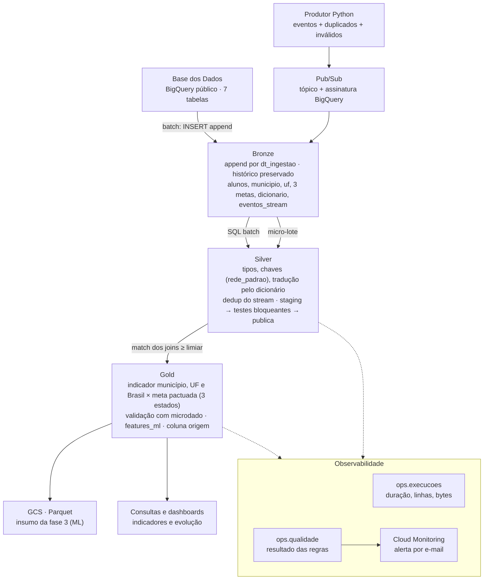

# Tech Challenge — Plano e Arquitetura

> Versão em Markdown de `docs/Tech Challenge — Plano e Arquitetura.pdf` (1/11/2026, @Halena).
> **Este arquivo é a fonte de verdade do plano**: atualize aqui (status, decisões, limiares
> medidos), não no PDF.

## Resumo

Pipeline medalhão inteiramente no GCP, com transformações em SQL no BigQuery orquestradas
por Python, ingestão batch das seis tabelas da Base dos Dados e um fluxo de streaming
simulado via Pub/Sub que chega até a Gold.

Decisões-chave:

- **Nuvem única (GCP):** o dataset já está no BigQuery público da Base dos Dados
  (`basedosdados.br_inep_avaliacao_alfabetizacao`), então não há egress nem transferência
  entre nuvens.
- **Bronze = cópia física versionada** das tabelas públicas para o nosso projeto,
  particionada por data de ingestão e escrita só em modo append. Ler direto do público em
  toda execução não preservaria histórico.
- **Silver e Gold em SQL** (BigQuery), executados por um orquestrador Python simples, com
  testes de qualidade entre cada camada que interrompem a execução.
- **Streaming:** produtor Python publica eventos no Pub/Sub; uma assinatura BigQuery grava
  na Bronze de eventos; um job de micro-lote deduplica, valida e promove à Silver e Gold com
  `origem = 'simulado'`.
- **Observabilidade:** tabelas `ops.execucoes` e `ops.qualidade` acumulando histórico, mais
  alerta do Cloud Monitoring por e-mail baseado em log de erro.
- **Meta:** distância até a meta usa sempre a **meta pactuada da fonte**; universalização
  (100%) aparece só como coluna separada chamada `cenario_aspiracional`.

## Arquitetura

O batch copia as tabelas oficiais para a Bronze por SQL; o streaming chega pela assinatura
BigQuery do Pub/Sub; a partir daí os dois caminhos passam pelas mesmas camadas, cada uma
publicada só depois dos testes.



Toda etapa grava métricas e resultados de qualidade nas tabelas `ops`, e erros disparam o
alerta por e-mail. **O diagrama do README deve mostrar só o que foi de fato implementado.**

## Decisões arquiteturais

Cada decisão abaixo vira um parágrafo do README, com o porquê e o que ela custa.

| Decisão | Escolha | Por quê | O que custa / risco |
| --- | --- | --- | --- |
| Forma de acesso à fonte | BigQuery público da Base dos Dados | Dado já está no BQ; zero transferência entre nuvens | Paga bytes escaneados na leitura; a Base dos Dados pode atualizar a tabela sem aviso |
| Atualização da fonte | Nova partição `dt_ingestao` a cada execução; Silver lê a partição mais recente | Preserva histórico e permite comparar versões | Armazenamento cresce a cada carga (pequeno; medir) |
| Lake vs warehouse | Warehouse (BigQuery) em todas as camadas; GCS só para exportar a Gold em Parquet | Uma ferramenta, SQL para tudo, sem cluster para gerenciar | Menos portável que Parquet puro; mitigado pela exportação |
| Batch vs streaming | Batch para as seis tabelas oficiais; streaming só para eventos simulados de atualização | A fonte oficial é anual; streaming real não faz sentido para ela | Dois caminhos de código para manter |
| Custo vs performance | Particionar por ano e clusterizar por UF/município; selecionar colunas explicitamente | Microdado de alunos é a tabela cara; reduz bytes escaneados | Exige disciplina nas queries (sem `SELECT *`) |
| Orquestração | Script Python com etapas encadeadas e retentativa (diferencial: Cloud Workflows ou Cloud Scheduler + Cloud Run Job) | Simples de reproduzir por um avaliador | Sem UI de DAG se ficar só no script |
| Meta de 2030 | Meta pactuada da fonte (`meta_alfabetizacao_2030`, 80 na rede pública) para distância; 100% só como `cenario_aspiracional` | Exigência explícita do enunciado | Nenhum, desde que as colunas tenham nomes distintos |

**Política de escrita na Bronze (obrigatório documentar):** `WRITE_APPEND` com coluna
`dt_ingestao` e `id_execucao`. **Nunca** `WRITE_TRUNCATE` nem `CREATE OR REPLACE` na Bronze.
Silver e Gold podem ser `CREATE OR REPLACE`, porque são reconstruíveis a partir da Bronze;
isso também vai no README.

## Camadas Bronze, Silver e Gold

As seis entidades entram na Bronze, são padronizadas na Silver e todas alimentam pelo menos
uma tabela Gold; a tabela `dicionario` é usada na Silver para traduzir códigos.

Nomes de coluna como `id_municipio`, `sigla_uf`, `ano`, `rede`, `serie` e
`taxa_alfabetizacao` seguem o padrão da Base dos Dados e **precisam ser confirmados** com
`INFORMATION_SCHEMA.COLUMNS` (resultado em `docs/dicionario_dados.md`, gerado por
`make perfil`).

### Bronze (`bronze.*`)

- Uma tabela por fonte: `bronze.alunos`, `bronze.municipio`, `bronze.uf`,
  `bronze.meta_brasil`, `bronze.meta_uf`, `bronze.meta_municipio`, `bronze.dicionario`,
  `bronze.eventos_stream`.
- Colunas originais sem transformação, mais `dt_ingestao` (DATE, partição), `id_execucao`
  (STRING) e `fonte` (tabela de origem).
- Escrita via `INSERT INTO ... SELECT <colunas explícitas> FROM basedosdados...` em modo
  append.
- Demonstração no README: rodar duas vezes e mostrar
  `SELECT dt_ingestao, id_execucao, COUNT(*) ... GROUP BY 1,2` com as duas cargas.

### Silver (`silver.*`)

- Lê apenas a partição mais recente de cada tabela Bronze.
- Padroniza tipos: `id_municipio` como STRING de 7 dígitos, `sigla_uf` maiúscula, `ano`
  INT64.
- Traduz `rede`, `serie` e presença pela tabela `dicionario`. Código sem tradução vira
  `'desconhecido'`, e um check bloqueante exige contagem zero.
- **Normaliza as chaves de rede entre tabelas:** o enunciado avisa que categorias podem ter
  representações diferentes no mesmo dataset. Criar uma coluna `rede_padrao` comum (ex.:
  `publica`, `estadual`, `municipal`, `total`) e comparar os valores distintos de cada lado
  antes do join.
- Preserva nulos. **Nunca** preencher proficiência ou meta com zero.
- `silver.alunos_avaliados`: filtra alunos presentes e com caderno preenchido, mantendo
  `peso_amostral`.

### Gold (`gold.*`)

| Tabela Gold | Grão | Entidades usadas | Para quê |
| --- | --- | --- | --- |
| `gold.indicador_municipio` | município × ano × rede | municipio, meta_municipio, uf (nome da UF e região) | Indicador vs meta municipal, com status em três estados |
| `gold.indicador_uf` | UF × ano × rede | uf, meta_uf | Indicador vs meta estadual |
| `gold.indicador_brasil` | ano × rede | uf (agregado ponderado), meta_brasil | Trajetória nacional vs meta pactuada |
| `gold.validacao_microdado` | UF × ano × rede | alunos, uf | Taxa recalculada do microdado vs taxa publicada (diferencial) |
| `gold.evolucao_temporal` | município × ano | municipio | Variação ano a ano do indicador |
| `gold.features_ml` | município × ano | municipio, uf, metas, alunos agregados | Base para a fase 3, sem colunas derivadas do alvo |

Regras de negócio que precisam estar no SQL da Gold:

- **Status da meta em três estados:** `atingiu`, `nao_atingiu`, `sem_meta`. Nunca deixar o
  `ELSE` classificar meta nula como "não atingiu".
- **Mesmo recorte:** só comparar resultado com meta quando `ano`, `rede_padrao` e `serie`
  coincidem.
- **Agregação nacional ponderada por alunos.** Se calcular média simples entre municípios,
  nomear a coluna `media_simples_municipios`.
- **Denominador = alunos avaliados com peso amostral:**
  `SUM(peso * alfabetizado) / SUM(peso)` sobre `silver.alunos_avaliados`.
- **Distância até a meta:** `meta_pactuada - taxa`, e separadamente
  `100 - taxa AS distancia_cenario_aspiracional`.
- **Coluna `origem`** (`oficial` ou `simulado`) em toda tabela que receber dado do streaming.
- Exportar `gold.features_ml` e `gold.indicador_municipio` para `gs://<bucket>/gold/` em
  Parquet com compressão Snappy, para a fase 3.

## Streaming

O streaming simula atualizações de indicador e meta por município, publicadas no Pub/Sub,
gravadas na Bronze por uma assinatura BigQuery e promovidas à Silver e Gold em micro-lotes
com `MERGE` idempotente.

### Componentes

1. `streaming/produtor.py` publica eventos JSON no tópico `eventos-alfabetizacao`, a uma taxa
   configurável (ex.: 5 eventos/s por 10 minutos).
2. Assinatura do tipo BigQuery (`write_metadata = true`) grava cada mensagem em
   `bronze.eventos_stream`, com `message_id` e `publish_time` do Pub/Sub.
3. `streaming/micro_lote.py` roda a cada N minutos (manual, ou Cloud Scheduler como
   diferencial): lê eventos novos desde a última marca d'água, valida, deduplica e faz
   `MERGE` em `silver.eventos_validos`.
4. A Gold de streaming (`gold.indicador_municipio_atualizado`) une oficial e simulado com a
   coluna `origem`.

### Formato do evento

```json
{"id_evento": "uuid", "tipo": "atualizacao_indicador", "id_municipio": "4206306",
 "ano": 2024, "rede": "publica", "taxa_alfabetizacao": 61.2,
 "ts_evento": "2026-11-05T14:03:11.120Z"}
```

### Regras que o avaliador vai procurar

- **Latência real:** `ts_evento` é gerado pelo produtor no momento da criação;
  `ts_ingestao` é o `publish_time` gravado pelo Pub/Sub, e há ainda `ts_processamento` no
  micro-lote. Latência = diferença entre eles. Nunca usar o mesmo carimbo nos dois campos.
- **Duplicados:** o produtor reenvia de propósito ~5% dos eventos com o mesmo `id_evento`. O
  micro-lote mantém só a primeira ocorrência
  (`QUALIFY ROW_NUMBER() OVER (PARTITION BY id_evento ORDER BY ts_ingestao) = 1`) e o `MERGE`
  impede inserir de novo o que já está na Silver.
- **Inválidos:** o produtor gera ~3% de eventos ruins (taxa fora de 0–100, município
  inexistente, JSON sem campo obrigatório). Eles vão para `silver.eventos_quarentena` com o
  motivo, e entram na contagem de métricas.
- **Separação oficial × simulado:** coluna `origem` obrigatória; a Gold oficial nunca recebe
  linha simulada.

### Batch × streaming (texto do README)

| Aspecto | Batch | Streaming |
| --- | --- | --- |
| Gatilho | Execução agendada ou manual | Chegada de evento |
| Frequência | Por carga da fonte (anual na prática) | Contínua, processada a cada N minutos |
| Latência | Horas a dias | Segundos a minutos (medida) |
| Garantia de entrega | Lote completo ou nada | Pelo menos uma vez; exige deduplicação |
| Reprocessamento | Reexecutar a partição | Reprocessar a partir da marca d'água |

## Qualidade de dados

Cada regra é uma query SQL que devolve o número de linhas problemáticas; regras bloqueantes
que falham levantam exceção e impedem a camada seguinte de ser publicada.

### Mecanismo (`quality/runner.py`)

- Regras declaradas em `quality/regras.yaml`: nome, camada, SQL, severidade (`bloqueante`
  ou `informativa`), limiar.
- Cada resultado é gravado em `ops.qualidade` (append): `id_execucao`, regra, camada, valor
  medido, limiar, status, timestamp.
- Se alguma bloqueante falhar: grava o resultado, levanta `QualidadeBloqueanteError` e o
  orquestrador termina com código de saída diferente de zero.
- **Sem `except Exception: log()` engolindo o erro.** O único `except` do orquestrador
  registra a falha em `ops.execucoes` e faz `raise` de novo.
- Silver e Gold são escritas primeiro em tabela de staging (`_stg`) e só copiadas para a
  tabela final depois que as regras passam. É isso que garante "antes da camada seguinte ser
  publicada".

### Regras mínimas

| Regra | Camada | Severidade | Limiar |
| --- | --- | --- | --- |
| Duplicidade na chave (município × ano × rede × série) | Silver | Bloqueante | 0 linhas |
| Código traduzido como `desconhecido` | Silver | Bloqueante | 0 linhas |
| `id_municipio` nulo ou fora de 7 dígitos | Silver | Bloqueante | 0 linhas |
| Taxa fora de 0–100 | Silver | Bloqueante | 0 linhas |
| Proficiência ausente em aluno presente | Silver | Informativa | registrar % |
| Taxa de match município × meta_municipio | Gold | Bloqueante | ≥ 99% (medido: 99,07% em 2023, 100% em 2024) |
| Taxa de match município × uf | Gold | Bloqueante | 100% |
| Taxa de match uf × meta_uf | Gold | Bloqueante | 100% das UFs com meta |
| Município sem meta (`sem_meta`) | Gold | Informativa | registrar contagem |
| Diferença taxa recalculada × publicada | Gold | Informativa | registrar pontos percentuais |
| Evento duplicado ou inválido no stream | Silver stream | Informativa | registrar contagem |

### Taxa de match dos joins (obrigatória)

Depois de cada `LEFT JOIN`, medir `COUNTIF(lado_direito.chave IS NOT NULL) / COUNT(*)`. O
limiar de cada join precisa ser justificado no README com dado observado: por exemplo, se a
meta municipal só existe para municípios que aderiram ao Compromisso, o limiar deve ser a
cobertura esperada, não 100%. **Primeiro medir, depois fixar.**

### Demonstrar a falha

- `scripts/injetar_falha/<tabela>__<cenário>.sql`, aplicado por
  `pipeline.orquestrador --injetar-falha <cenário>` na staging da Silver, depois de montada e
  antes das regras (implementado: `resultado_municipio__rede_desconhecida` e
  `__chave_duplicada`).
- Rodar a pipeline, capturar o print do erro, a linha `status = 'falhou'` em `ops.qualidade`
  e o e-mail de alerta. Essas três evidências vão para `evidencias/`.

## Monitoramento e observabilidade

Toda etapa grava uma linha em `ops.execucoes` e toda falha gera um log de severidade ERROR
que dispara um alerta por e-mail no Cloud Monitoring.

### Métricas persistidas (`ops.execucoes`, append, particionada por data)

| Coluna | Exemplo |
| --- | --- |
| `id_execucao`, `etapa`, `camada` | `2026-11-05T14:00_ab12`, `silver_municipio`, `silver` |
| `inicio`, `fim`, `duracao_s` | medidos com `time.monotonic()` em volta da etapa |
| `linhas_entrada`, `linhas_saida` | do `num_dml_affected_rows` ou `COUNT(*)` |
| `bytes_processados`, `bytes_faturados` | do objeto `QueryJob` do cliente BigQuery |
| `status`, `mensagem_erro` | `sucesso` / `falhou` |
| `latencia_p50_s`, `latencia_p95_s` | só no micro-lote de streaming |

### Alertas

- O orquestrador escreve logs estruturados no Cloud Logging (`google-cloud-logging`).
- Métrica baseada em log: contagem de entradas com `severity=ERROR` e
  `labels.pipeline=alfabetizacao`.
- Política de alerta no Cloud Monitoring: qualquer ocorrência em 5 minutos → canal de
  notificação por e-mail do grupo.
- Opcional (diferencial): segunda política para "pipeline não rodou em 26 h", baseada na
  ausência de linha em `ops.execucoes`.
- Prints da política criada e do e-mail recebido vão para `evidencias/`.

### Dashboard simples

Uma consulta salva ou um Looker Studio sobre `ops.execucoes` e `ops.qualidade`: duração por
etapa, volume por execução, latência do streaming e regras reprovadas.

**Resposta para o README:** em produção, o canal de e-mail do time recebe o alerta em até
~5 minutos após a falha (janela da política mais atraso de ingestão de log). Se o job nem
iniciar, a política de ausência avisa em até 26 h. Medir o tempo real entre o erro e a
chegada do e-mail no teste de falha e citar esse número.

## FinOps

A estimativa de custo sai de números medidos pela própria pipeline (bytes faturados por
query, tamanho das tabelas, volume de mensagens), gravados em `ops.execucoes`, multiplicados
pelos preços de lista do GCP.

### Como medir

- **Dry run antes de cada query** (`QueryJobConfig(dry_run=True)`): grava `bytes_estimados`
  e permite abortar se passar de um teto configurado.
- **`maximum_bytes_billed` em toda query**, como trava contra `SELECT *` acidental na tabela
  de alunos.
- **Bytes reais:** `job.total_bytes_billed` de cada execução, já gravado em `ops.execucoes`.
- **Armazenamento:** `INFORMATION_SCHEMA.TABLE_STORAGE` (bytes lógicos e físicos por tabela)
  e `gsutil du -s` no bucket.
- **Pub/Sub:** número de mensagens × tamanho médio, ou a métrica `subscription/byte_cost` no
  Cloud Monitoring.
- **Antes/depois de otimização:** medir a query da Silver de alunos com `SELECT *` e com
  colunas explícitas + filtro de partição, e mostrar a redução em bytes. É a evidência de
  FinOps mais convincente.

**Região:** criar todos os datasets na multi-região **US**, a mesma do projeto público
`basedosdados`. O BigQuery não faz join entre locais diferentes, e copiar para outra região
geraria transferência paga.

### Tabela de estimativa

Preenchida no README (seção FinOps), com as quantidades medidas por
`scripts/medir_custos.py` e os preços consultados nas páginas oficiais em 03/11/2026.

Se o grupo usar a camada gratuita ou créditos de avaliação, dizer isso no README e projetar o
custo do mesmo desenho em produção com a cadência pretendida, por exemplo: batch mensal +
streaming contínuo de N eventos/dia. Projetar com a cadência real, não com premissa inflada.

## Repositório e reprodutibilidade

Um avaliador deve rodar tudo com `cp .env.example .env`, `make setup` e `make pipeline`, sem
editar código.

```
tech-challenge-alfabetizacao/
├── README.md
├── .env.example            # GCP_PROJECT, BQ_LOCATION=US, GCS_BUCKET, PUBSUB_TOPIC, ALERT_EMAIL
├── .gitignore              # .env, *.json de credencial
├── requirements.txt        # versões fixadas
├── Makefile                # setup, pipeline, stream, falha, testes
├── config/settings.py      # lê o .env; único lugar com IDs
├── infra/                  # scripts gcloud/bq (ou Terraform como diferencial)
│   └── setup.sh            # cria datasets, tópico, assinatura, bucket, alerta
├── pipeline/
│   ├── orquestrador.py     # encadeia etapas, retentativa, grava ops.execucoes
│   ├── bq.py               # cliente, dry run, maximum_bytes_billed
│   ├── bronze/             # *.sql de ingestão append
│   ├── silver/             # *.sql de limpeza e padronização
│   └── gold/               # *.sql analíticos + export Parquet
├── streaming/
│   ├── produtor.py         # gera eventos, duplicados e inválidos
│   └── micro_lote.py       # dedup, quarentena, MERGE, latência
├── quality/
│   ├── regras.yaml
│   └── runner.py
├── scripts/injetar_falha.sql
├── tests/                  # pytest das funções de transformação/validação
├── docs/                   # diagrama, dicionário de dados, investigação de anomalias
└── evidencias/             # prints, job IDs, contagens, e-mail de alerta
```

### Checklist de clone limpo (fazer antes de entregar)

- [ ] Clonar em outra pasta, criar `.env` a partir do exemplo e rodar só o que o README manda.
- [x] Todo caminho citado no README existe com o mesmo nome (conferido em 03/11/2026).
- [x] `requirements.txt` com versões fixadas.
- [x] Nenhum ID de projeto ou bucket fixo fora de `config/settings.py` e `.env` (só aparece no log de evidência).
- [x] `git log -p | grep -i private_key` não retorna nada (além desta própria linha).
- [x] `pytest` passa (238 testes).

## Roteiro de tarefas

Quatro fases sequenciais; ajustar as datas ao prazo de entrega, que não está no enunciado. As
frentes Streaming e Qualidade/Monitoramento podem andar em paralelo a partir da fase 2.

Legenda: `[x]` feito · `[~]` código pronto, falta rodar no GCP / gerar evidência · `[ ]` a fazer.

### Fase 1 — Fundação e perfil dos dados

- [~] Criar projeto GCP, habilitar BigQuery, Pub/Sub, Cloud Storage, Logging e Monitoring
  (feito); configurar alerta de orçamento (não feito).
- [x] Criar repositório com a estrutura acima, `.env.example` e `config/settings.py`.
- [x] Listar colunas reais das sete tabelas via `INFORMATION_SCHEMA.COLUMNS` e registrar em
  `docs/dicionario_dados.md`.
- [x] Comparar valores distintos de `rede` e `serie` entre `municipio`, `uf`, metas e
  `dicionario`. Anotar as divergências: são o insumo da normalização de chaves.
- [x] Dry run de `SELECT *` na tabela de alunos para saber o tamanho real (256,1 MiB).

### Fase 2 — Bronze e Silver

- [x] `infra/setup.sh` cria datasets `bronze`, `silver`, `gold`, `ops` em US (e as tabelas
  `bronze.*` via `infra/sql/bronze.sql`).
- [x] SQLs de Bronze em append com `dt_ingestao` e `id_execucao` (`pipeline/bronze/*.sql`,
  `make bronze`), executados duas vezes, com evidência em `evidencias/`.
- [x] SQLs de Silver com tradução via `dicionario`, `rede_padrao`, tipos padronizados e
  `alunos_avaliados` (`pipeline/silver/*.sql`, `make silver`), executados no GCP.
- [x] `quality/runner.py` + regras bloqueantes da Silver + staging antes de publicar;
  executado (51 regras em `ops.qualidade`) e falha demonstrada.
- [x] `ops.execucoes` gravada pelo orquestrador (`pipeline/orquestrador.py`), uma linha por
  tabela em Bronze, Silver, Gold e streaming.

### Fase 3 — Gold, streaming e monitoramento

- [x] SQLs de Gold com status em quatro estados (`sem_resultado` além dos três previstos),
  ponderação por alunos e mesmo recorte de rede/série (`pipeline/gold/*.sql`, `make gold`),
  executados.
- [x] Taxa de match após cada join, com limiares medidos e confirmados na execução
  (99,07% município × meta; 24/26/27 UFs; ≤ 3 UF e ≤ 802 município sem microdado).
- [x] `gold.validacao_microdado`: taxa recalculada comparada com a publicada; diferenças
  investigadas e documentadas (§10). Brasil 2024 bate com exatidão; SP 2023 ausente da fonte.
- [x] Produtor + assinatura BigQuery + micro-lote com dedup, quarentena, latência e `origem`
  (`streaming/`, `infra/sql/streaming.sql`, `make produtor`, `make micro-lote`), executado.
- [x] Política de alerta baseada em log (Cloud Logging → Monitoring → e-mail) em
  `pipeline/observabilidade.py` e `scripts/criar_alerta.py`, criada e testada com
  `--injetar-falha`: e-mail em menos de 1 minuto.
- [x] Exportar Gold em Parquet para o bucket (insumo da fase 3 do curso): `EXPORT DATA` em
  `gs://<bucket>/gold/<tabela>/id_execucao=<id>/`, executado para as 6 tabelas.

### Fase 4 — FinOps, documentação e vídeo

- [x] Tabela de custo preenchida com números medidos (`scripts/medir_custos.py`,
  `docs/perfil/medicoes_custo.json`) e projeção para a cadência de produção.
- [x] README com todas as seções exigidas, usando "planejado" para o que não foi feito (falta só o link do vídeo).
- [x] Diagrama (Mermaid, no README) refletindo só o implementado.
- [x] Pasta `evidencias/` completa: job IDs, contagens, prints, falha demonstrada, e-mail de
  alerta.
- [ ] Teste de clone limpo.
- [ ] Vídeo de até 5 min: problema, arquitetura, valor, uso em IA; números iguais aos do
  repositório e gráficos com eixos rotulados.

### Divisão sugerida (grupo de 4–5)

| Frente | Responsável | Entrega principal |
| --- | --- | --- |
| Infra + Bronze + orquestrador | _definir_ | `infra/`, `pipeline/bronze/`, `orquestrador.py` |
| Silver + Gold | _definir_ | SQLs, regras de negócio, validação cruzada |
| Streaming | _definir_ | `streaming/`, latência, dedup |
| Qualidade + monitoramento + FinOps | _definir_ | `quality/`, alertas, tabela de custo |
| README + vídeo | _definir_ (todos revisam) | documentação, evidências, roteiro do vídeo |

### Seções do README que costumam faltar

- **Aplicação em IA:** descrever `gold.features_ml` com alvo `taxa_alfabetizacao` do ano
  seguinte; excluir colunas derivadas do alvo do mesmo ano (status da meta, distância até a
  meta, flag de alfabetizado agregada). Isso evita vazamento de alvo.
- **Limitações conhecidas:** dados simulados no streaming, poucos anos de série (projeção até
  2030 é cenário), UFs sem resultado em algum ano, limiares de match escolhidos por
  observação.
- **Link do vídeo executivo.**

## Decisões e medições registradas

Anotar aqui, com data, o que for decidido ou medido durante a implementação (limiares de
match, divergências de chaves, tamanhos de tabela, etc.).

- **2026-11-02 — perfil da fonte** (`docs/dicionario_dados.md`): `alunos` tem 3,87 mi de
  linhas e 256,1 MiB (`SELECT *`); as demais tabelas somam menos de 3 MiB. A coluna de peso
  do microdado se chama `peso_aluno` (não `peso_amostral`).
- **2026-11-02 — divergências de chave para a Silver:**
  - `rede` usa códigos em `alunos` (`2`, `3`, `4`), `municipio` e `uf` (`0`, `2`, `3`, `5`),
    mas texto nas metas (`Pública` em Brasil/UF, `Municipal` em município). Tradução dos
    códigos via `dicionario`; daí `rede_padrao`.
  - Metas de Brasil e UF têm `ano = 2025`, que não existe nos resultados (só 2023 e 2024).
  - `uf` não tem resultado para `DF` e `RR`, mas `meta_alfabetizacao_uf` tem: o match
    uf × meta_uf não será 100% das 27 UFs.
  - `alunos` traz `presenca`, `preenchimento_caderno` e `alfabetizado` como STRING `0`/`1`.
- **2026-11-02 — Bronze:** tabelas particionadas por `dt_ingestao` e clusterizadas por
  `ano` + `id_municipio`/`sigla_uf`. Cada INSERT tem um `NOT EXISTS` por
  (`dt_ingestao`, `id_execucao`), para que a retentativa do orquestrador não duplique uma
  carga que já tinha sido gravada. Duas execuções no mesmo dia geram duas cargas, com
  `id_execucao` diferentes; a Silver deve ler a carga mais recente por `id_execucao`, não
  só pela partição.
- **2026-11-02 — dicionário da fonte** (`evidencias/fase1_dicionario_agregado.csv`): cada
  par (coluna, chave) tem um único significado em todas as tabelas, então uma tradução só
  serve para `alunos`, `uf` e `municipio`. Os códigos de rede `1` (Federal) e `6`
  (Pública com Federal) existem no dicionário, mas não aparecem nos dados.
  `meta_alfabetizacao_municipio.nivel_alfabetizacao` não tem entrada no dicionário.
- **2026-11-02 — perguntas abertas para a Silver**, respondidas por
  `scripts/investigar_fonte.py` (`make investigar`, saída em `docs/perfil/investigacao.json`):
  `'Pública'` das metas corresponde ao código `5` ou ao `6`? `'Municipal'` corresponde ao
  `3`? DF e RR têm dado em `municipio`/`alunos`? Quantos municípios com meta ficam sem
  resultado (base do limiar de match)? **Respondidas em `docs/investigacao.md`.**
- **2026-11-02 — investigação** (`docs/investigacao.md`, execução `20261102T165554Z_c2e682`):
  `'Pública'` = rede `5`; `'Municipal'` = rede `3`, confirmados (2024: 100% idêntico;
  2023: 95,2% dentro de 0,05 p.p.). Dos 256 casos de 2023 fora de 0,05 p.p., 70 têm taxa nula
  na meta, 183 são arredondamento na fronteira de 0,05 e **3 divergem de verdade**
  (2305100, 2304905, 5106752). O resultado vem sempre de `municipio`; uma regra informativa
  usa tolerância de 0,06 p.p. UF-ano sem resultado: AC 2023, DF 2023, RR 2023 e 2024 (DF 2024
  vem de Brasília). DF 2024 =
  Brasília (59,13, idêntico à meta_uf). Match meta_municipio → municipio(rede 3): 99,07% em 2023 e 100% em
  2024, **limiar bloqueante 99%**. Match meta_uf → uf(rede 5): 49 de 54 pares UF-ano (sem
  DF e RR, e falta um terceiro par); limiar a fixar no valor observado. RR não tem
  resultado em 2023–2024; DF só em 2024, via `municipio`/`alunos`. `nivel_alfabetizacao`
  = faixa da taxa, excluída das features. Avaliados = presente e caderno preenchido;
  ausentes têm `alfabetizado = '0'`.
- **2026-11-02 — Bronze executada duas vezes:** `bronze.municipio` com duas cargas de
  23.995 linhas cada (`20261102T165638Z_2131d7` e `20261102T193509Z_1b0fa9`),
  `evidencias/fase2_bronze_duas_cargas_municipio.csv`.
- **2026-11-02 — travas da Bronze** (`pipeline/orquestrador.py`): o DDL de
  `infra/sql/bronze.sql` é o contrato. Coluna da fonte removida ou com tipo alterado
  interrompe antes do `INSERT`; coluna nova só gera aviso. Depois do `INSERT`, as linhas
  gravadas precisam ser iguais a `num_rows` da fonte. Se o `INSERT` devolver 0 (retentativa
  barrada pelo `NOT EXISTS`), a conferência usa `COUNT(*)` da carga. Retentativa: 3
  tentativas só para 5xx/429, com espera de 5 s e 10 s. `bronze.alunos` tem
  `require_partition_filter = TRUE`.
- **2026-11-02 — consultas da Base dos Dados** (`consultas_basedosdados/`): o site traduz
  os códigos com join em `dicionario` por (`id_tabela`, `nome_coluna`, `chave`), e os nomes
  de município e UF vêm de `basedosdados.br_bd_diretorios_brasil`. Como `municipio` e
  `meta_municipio` não têm `sigla_uf`, a Silver precisa do diretório de municípios (ou do
  prefixo IBGE de 2 dígitos) para ligar município a UF. **Decidido: ingerir
  `br_bd_diretorios_brasil.municipio` como 8ª tabela da Bronze** (`FONTE_DIRETORIOS` no
  `.env`). Ele traz nome, UF e região, que servem a dashboards e como feature. Colunas
  confirmadas por `diretorio_colunas` (27 na fonte). A Bronze guarda 8 em
  `bronze.diretorio_municipio`; ver `docs/investigacao.md` §9.
- **2026-11-02 — carga do diretório** (`20261102T200747Z_3176ea`): `bronze.diretorio_municipio`
  com 5.571 linhas. **Medição de FinOps:** o dry run estimou 370,1 KiB, mas o job faturou
  20,0 MiB. O BigQuery cobra no mínimo 10 MB por tabela referenciada, e a carga lê a fonte
  e o destino (`NOT EXISTS`). Nas tabelas pequenas, o custo por execução é esse piso, e não
  o volume. Consequência: as regras de qualidade de cada tabela rodam numa única query, e
  não numa query por regra.
- **2026-11-02 — Silver:** a carga lida é a mais recente com sucesso em `ops.execucoes`
  (marcador `{carga_<tabela>}`). Publicação: staging, regras, copy job (gratuito) e remoção
  da staging; se reprovar, a staging fica para inspeção. As regras de cada tabela rodam numa
  query só, por causa do piso de 10 MB. `dt_ingestao` passou a ser derivada do
  `id_execucao`, para a Silver reconstruir o filtro de partição sem consultar a Bronze.
  Joins com o diretório usam limiar de 100%; os limiares medidos (99% município × meta e
  cobertura observada de UF) ficam para os joins resultado × meta, na Gold.
- **2026-11-02 — Silver executada:** as 51 regras foram gravadas em `ops.qualidade`
  (`evidencias/fase2_silver_qualidade.csv`), e as 44 bloqueantes aprovaram. Contagens:
  `alunos_avaliados` 3.354.661 (= 1.502.809 + 1.851.852 da investigação; 86,7% dos registros),
  `resultado_municipio` 23.995, `resultado_uf` 145, `meta_municipio` 10.704, `diretorio`
  5.571. As 2 informativas reprovadas tinham exatamente o valor previsto (120 metas
  municipais sem taxa, 2 linhas de RR sem meta 2030). Os limiares foram recalibrados para o
  valor medido com `<=`, para que "reprovada" passe a significar "piorou".
- **2026-11-02 — falha demonstrada** (`20261102T204419Z_22674a`): cenário
  `resultado_municipio__rede_desconhecida`. A regra bloqueante reprovou (valor 1, limiar 0),
  a etapa ficou `falhou` com `QualidadeBloqueanteError` e o processo saiu com código 1. A
  staging ficou com 1 linha de rede `'9'` e a tabela publicada com 0. Prints em
  `evidencias/fase2_pipeline_falhou.jpg` e `fase2_demonstracao_falha{1,2,3}.jpg`. Falta o
  alerta por e-mail (fase de monitoramento).
- **2026-11-02 — FinOps (Silver):** a staging de `resultado_municipio` foi estimada em 5,2 MiB e
  faturada em 40,0 MiB, pelo piso de 10 MB por tabela referenciada (bronze.municipio,
  diretorio, rede, dicionario). Cada consulta de regras faturou 10 MiB.
- **2026-11-02 — Gold implementada:**
  - **Status:** 4 estados, porque meta sem resultado (AC, DF, RR) e rede sem meta são
    situações diferentes. A meta do ano Y vem da publicação Y.
  - **Fonte do resultado de UF:** `resultado_uf`, depois o único município da UF (DF 2024),
    depois `meta_uf` (2025).
  - **Validação:** `validacao_microdado` lê `alunos_avaliados` uma vez e soma por município
    → UF → Brasil; `indicador_brasil` e `features_ml` reaproveitam essa tabela.
  - **Features:** alvo = taxa municipal de t+1; status, distâncias e faixa ficam fora, e
    uma regra bloqueante lê o `INFORMATION_SCHEMA` para garantir isso.
  - **Exportação:** em Parquet/Snappy, num prefixo por `id_execucao`.
- **2026-11-02 — 1ª execução da Gold** (`20261102T230818Z_2d4702`):
  - **Publicadas e exportadas:** `indicador_municipio` (24.045 linhas) e `indicador_uf` (178),
    em Parquet no bucket. Todos os limiares medidos na investigação bateram exatamente:
    match município × meta 99,07%, 3 divergências de taxa, 24/26/27 UFs com resultado em
    2023/2024/2025 e 2 linhas de DF via Brasília.
  - **Parou em `validacao_microdado`:** a regra bloqueante `validacao_microdado_match_uf`
    reprovou com 97,9% (142 de 145 linhas de UF publicadas com microdado). As informativas
    também ficaram fora do esperado: match de município 96,7%, maior diferença em UF
    1,49 p.p., Brasil 1,56 p.p. A staging foi mantida para investigação (consultas
    `validacao_*` em `scripts/investigar_fonte.py`). A validação leu 212 MiB, a maior
    leitura da Gold.
- **2026-11-02 — validação cruzada investigada** (`docs/investigacao.md` §10):
  - **Causa da reprovação:** SP 2023 não está nos microdados da fonte. São as 3 linhas de UF
    e 801 das 802 de município sem par.
  - **Brasil 2024:** recalculada 59,20 contra oficial 59,2 (diferença 0,00). Isso confirma a
    pipeline de ponta a ponta.
  - **Brasil 2023:** +1,56 p.p. sem SP; com SP estimado, a diferença cairia para ~0,4 p.p.
  - **Peso amostral:** MS 2023 tem todo peso = 1.
  - **Regras:** recalibradas em contagem (≤ 3 UF, ≤ 802 município); `brasil_2024 ≤ 0,05`
    passou a ser bloqueante. Nova coluna `n_ufs_com_microdado`.
- **2026-11-02 — Gold completa** (`20261102T232157Z_b0292a`):
  - **Execução:** as 4 tabelas restantes foram publicadas e exportadas; as 22 regras
    bloqueantes da Gold aprovaram.
  - **Brasil 2024:** diferença de 0,00 entre recalculada e oficial.
  - **`features_ml`:** 10.896 linhas, sem coluna com vazamento. 52 municípios têm resultado
    em 2023 e não em 2024 (limiar recalibrado para ≤ 52).
  - **Erro na fonte (§10):** para 2305100 e 2304905 em 2023, microdados e meta concordam
    (55,6 e 83,1), e `municipio` está errado (91,67 e 99,15).
  - **Custo:** `validacao_microdado` é a única leitura relevante (212 MiB); as outras tabelas
    ficam no piso de 10 MB por tabela referenciada.
- **2026-11-03 — streaming implementado:**
  - **Recepção:** assinatura BigQuery com `write_metadata` em `bronze.eventos_stream`. A
    permissão de escrita da conta do Pub/Sub é no nível da tabela.
  - **Micro-lote:** processa por marca d'água (`ops.marca_dagua_stream`), com margem de 30 s.
    Validação com 7 motivos; dedup por `id_evento` no lote e contra a Silver; `MERGE`
    idempotente; quarentena por `message_id`.
  - **Gold:** é uma VIEW (`gold.indicador_municipio_atualizado`), então o evento chega à
    camada analítica sem uma cópia extra.
  - **Rastreio dos defeitos:** o produtor marca `tipo_envio`, e a regra bloqueante
    `eventos_lote_defeito_nao_detectado` confere se o validador pegou todos os defeitos
    injetados.
  - **Desvio em relação ao plano:** a latência de ingestão usa `publish_time − ts_evento`;
    o plano previa `ts_ingestao` separado, mas é o próprio `publish_time`.
- **2026-11-02 — streaming executado** (`evidencias/fase3_streaming_terminal.txt`):
  - **Conciliação exata:** 626 mensagens = 588 válidas novas + 26 duplicadas + 12 inválidas,
    divididas em dois lotes com dados.
  - **Latência de ingestão:** p50 de 0,073 s e p95 até 0,976 s. Ponta a ponta, o p95 fica
    entre 80 e 122 s, dominado pelo intervalo do lote.
  - **Custo:** ≈ 100 MiB por lote com eventos e ≈ 40 MiB por lote vazio, tudo pelo piso de
    10 MB. Um lote a cada 5 min cabe na cota gratuita de 1 TiB/mês.
- **2026-11-02 — alerta:**
  - **Tipo de política:** baseada em log (`conditionMatchedLog`), em vez de métrica de log +
    limiar. Ela dispara a cada entrada ERROR, sem esperar janela de agregação.
  - **Volume de log:** só WARNING para cima vai ao Cloud Logging (FinOps), com transporte
    síncrono para não perder o erro na saída do processo.
  - **Exceções fora das etapas:** viram CRITICAL em `rodar_com_alerta`.
- **2026-11-02 — alerta testado:**
  - **Tempo medido:** erro às 21:31 e e-mail às 21:31 (incidente às 00:31 UTC), ou seja,
    menos de 1 minuto.
  - **Evidências:** `evidencias/fase4_*`.
- **2026-11-02 — FinOps medido** (`docs/perfil/medicoes_custo.json`):
  - **Pipeline batch:** 1,84 GiB por execução completa.
  - **Micro-lote:** ≈ 100 MiB com eventos e ≈ 40 MiB vazio.
  - **Armazenamento:** 1,42 GiB no BigQuery e 1,94 MiB de Parquet por exportação.
  - **Pub/Sub:** 282 B por mensagem.
  - **Projeção mensal** (batch mensal + lote a cada 5 min): ≈ US$ 5,20 sem cota gratuita
    e US$ 0 com ela. Corrigida em 03/11/2026 (ver abaixo).
  - **Achados:** colunas de controle somam 317 MiB por carga de `bronze.alunos`; duas
    cargas no mesmo dia fazem a Silver ler 724 MiB. Correções planejadas: armazenamento
    físico ou `fonte` curta, e cluster por `id_execucao`.
  - **`TABLE_STORAGE` dá 403:** o armazenamento é medido pela API de metadados.
- **2026-11-03 — README fechado:**
  - **Seções novas:** contexto, arquitetura (diagrama Mermaid só com o implementado),
    tecnologias (implementado × evolução futura), estrutura do repositório, decisões
    arquiteturais (forma de acesso, custo e atualização da fonte), evidências,
    limitações, evolução futura e diferenciais.
  - **Dependências:** `google-auth` e `requests` declarados com versão (usados por
    `scripts/criar_alerta.py`).
- **2026-11-03 — preços conferidos nas páginas oficiais:**
  - **Alerta baseado em log:** US$ 0,35 por referência de métrica por mês, sem custo de
    pontos retornados (exemplo 7 da página de exemplos de preço do Observability).
  - **Armazenamento ativo lógico:** US$ 0,023/GiB-mês, e não US$ 0,02.
  - **Assinatura BigQuery do Pub/Sub:** US$ 50/TiB, sem cota gratuita, separada da
    publicação (US$ 40/TiB, 10 GiB grátis).
  - **Nova projeção:** ≈ US$ 5,62/mês sem cota gratuita e ≈ US$ 0,38 com ela.
- **2026-11-03 — revisão do README:**
  - **Tempo verbal:** trechos no futuro sobre coisas já feitas (Silver, diretório, origem
    do streaming) passaram para o presente.
  - **Demonstração de falha:** 7 regras aprovadas, e não 8.
  - **Alerta:** toda exceção que encerra o processo vira CRITICAL.
  - **`SELECT *`:** a afirmação passou a ser exata; ele aparece só sobre CTEs e tabelas do
    projeto.
  - **`except Exception`:** os 4 casos estão explicados no README.
  - **Sumário e nota do alerta:** sumário com links no topo; nota sobre a demora do alerta
    depois de criado.
